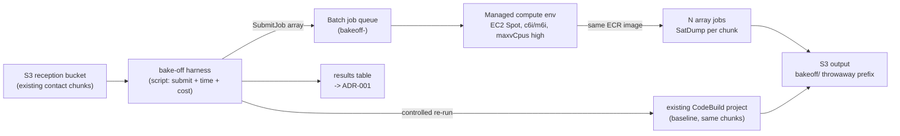

# Design: Compute Bake-off — AWS Batch on EC2 Spot vs CodeBuild

## Overview

A throwaway, measurement-only experiment to replace ADR-001's list-price estimates with one
real data point: run a single already-received contact's SatDump chunks through AWS Batch on
EC2 Spot, measure actual cost and wall-clock, and compare against the same chunks on the
existing CodeBuild project. Everything is gated behind `enable_compute_bakeoff = false` and
torn down at the end. No production resource is touched.

## Why this shape

- **Fan-out only, no CSPP.** The chunk stage runs SatDump, which needs no internet — so it can
  be baked off before PERF-1. CSPP aggregation is deferred (Requirement 5).
- **Same image, same inputs.** Comparing platforms, not images: the Batch job definition points
  at the existing ECR image and runs the same per-chunk command on the same S3 inputs, writing
  to a `bakeoff/` throwaway prefix.
- **Remove the throttle to measure it.** The ADR's core finding is that CodeBuild's account
  concurrency cap paces the fan-out. The Batch compute environment sets `maxvCpus` high enough
  to run all chunks of the test contact at once — that is precisely the variable under test.

## Architecture (experiment)

## Components

| Layer | Resource | Notes |
|---|---|---|
| Terraform module | `infra/modules/compute_bakeoff/` | gated by `enable_compute_bakeoff` (default false); self-contained |
| Compute env | `aws_batch_compute_environment` (MANAGED, EC2 SPOT) | instance types `c6i`/`m6i` ≈ 2XLARGE class; `max_vcpus` ≥ N_chunks × 8; `bakeoff-` prefix; `Disposable=true` tag; Spot allocation `SPOT_CAPACITY_OPTIMIZED` |
| Job queue | `aws_batch_job_queue` | single CE; `bakeoff-` prefix |
| Job definition | `aws_batch_job_definition` (container) | existing ECR image; same entrypoint/args as the CodeBuild chunk buildspec; vCPU/memory matched to 2XLARGE class |
| IAM | Batch service role, instance role, job execution role | least-privilege: S3 read on reception bucket, S3 write on `bakeoff/*` only, ECR pull on the sdr image repo, KMS, logs — mirrors the chunk CodeBuild role, scoped tighter to `bakeoff/` |
| Harness | `scripts/bakeoff/run_bakeoff.sh` + `scripts/bakeoff/_measure.py` | submits the array job, polls to completion, pulls wall-clock + Cost Explorer / Spot cost, runs the CodeBuild baseline, writes the results table |

## Measurement method

- **Wall-clock (Batch):** submit timestamp → last array element SUCCEEDED, from `describe_jobs`.
- **Queue/scheduling delay:** job `createdAt` → `startedAt` per element.
- **Spot interruptions:** count array elements with `attempts > 1` / Spot reclaim reason.
- **Cost (Batch):** actual — tag all resources `Objective=compute-bakeoff`, read incurred cost
  from Cost Explorer filtered on that tag for the run window; cross-check against Spot instance
  runtime × observed Spot price. **Not list price.**
- **Wall-clock + cost (CodeBuild baseline):** a controlled `start-build` re-run of the same
  chunks (not a production trigger), build-minutes × published 2XLARGE rate, plus measured queue
  time from the build phases.
- **Correctness:** compare per-chunk output object count + sizes between platforms — the swap
  must not change the result.

## Teardown

`terraform destroy -target module.compute_bakeoff` (or flip `enable_compute_bakeoff = false` and
apply), then a verification script asserts no `bakeoff-` Batch resources and no running Spot
instances tagged `Objective=compute-bakeoff`. The `bakeoff/` S3 prefix is deleted. The module
source may remain in-repo (default-off) for repeatability.

## Verification / workflow

Runs under the Well-Architected Delta Workflow
([`.kiro/steering/wa-delta-workflow.md`](../../steering/wa-delta-workflow.md)): Terraform →
`terraform` subagent, plan-only + Checkov security gate on the module; the harness scripts →
`python` subagent with moto where applicable. The one deviation: this spec is permitted to run
an actual (throwaway, Spot, single-contact) workload because *measurement is its deliverable* —
but it is still plan-only for Terraform **apply** from the agent's side; the operator applies
the gated module and runs the harness, since it incurs real (small, Spot) cost and touches the
account.

## Cost of the experiment itself

One contact's worth of Spot compute (~$1–2 estimated) + one CodeBuild baseline re-run (~$7–9) +
negligible S3. Bounded, one-time, and the entire point is to spend that once to avoid guessing.

## Risks

- **Spot capacity for the chosen instance shape in `eu-central-1`** may be thin — if so, the run
  itself becomes a data point (fall back to Fargate as ADR-001's secondary, noted but not built
  here).
- **Instance-shape mismatch** vs CodeBuild's opaque 2XLARGE sizing — documented as an
  approximation; the comparison is order-of-magnitude by design.
