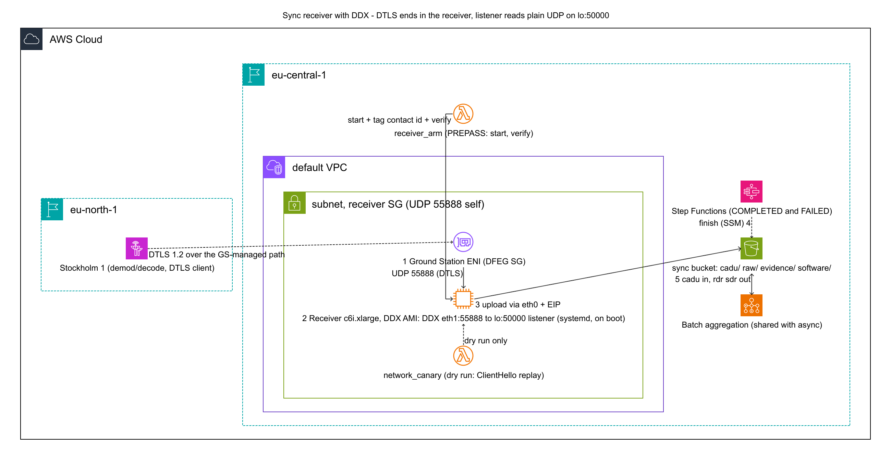
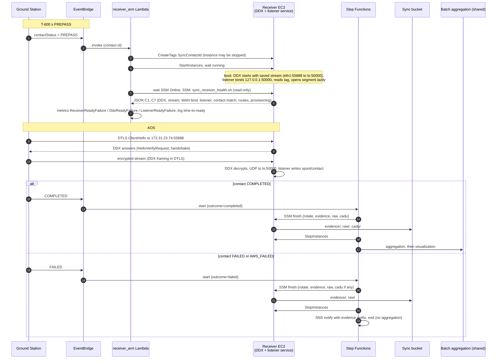

# Design: Sync Receiver Rebuilt Around the Dataflow Endpoint Application (DDX)

Requirements: [`requirements.md`](requirements.md) (ids `R<n>.<m>` below). Facts this design rests
on are in [`docs/DDX_AMI_INSPECTION.md`](../../../docs/DDX_AMI_INSPECTION.md),
[`docs/LESSONS_SYNC_FIRST_CONTACTS.md`](../../../docs/LESSONS_SYNC_FIRST_CONTACTS.md) and the
untracked desk research `.agents/tasks/ddx-dataflow-endpoint-2026-11-26/findings.md`. Labels:
**[verified]** seen on the AMI or in this account, **[doc]** AWS documentation / AWS template,
**[assumed]** reasoned, not seen.

## 1. Overview

Ground Station opens a DTLS 1.2 session to the dataflow endpoint address `172.31.23.74:55888` and
streams only once the session is up. Today nothing on the receiver answers. The new receiver runs
the AWS DDX from the shared AMI. DDX owns the WAN socket (`eth1:55888`), terminates DTLS, and sends
each decrypted datagram as plain UDP to `127.0.0.1:50000`. Our listener, now a systemd service that
starts at boot, reads that port and files the frame stream under the current contact id. Everything
after the frames in S3 is unchanged and shared with the async path (architecture principle
"converge early, mutualize the rest").

The operating model follows the AWS template (decision D4): nothing is armed per contact. At PREPASS
the `receiver_arm` Lambda labels the instance with the contact id (a tag the listener reads over
IMDS), starts it, and **verifies** readiness; capture never depends on a pre-AOS command. After the
pass (COMPLETED or FAILED) the state machine runs finish, which rotates the listener's segment,
uploads evidence first, then the frames, then stops the instance.

**Technology stack (locked on approval):** Terraform (AWS provider `~> 5`, `awscc` for the DFEG);
Lambda Python 3.12; on-instance Python 3.9 (AL2023 system python) and bash; systemd; DDX 2.6.2 from
AMI `groundstation-al2023-ddx2.6.2-ami-*`; SSM Run Command for read-only verification and for finish;
IMDSv2 instance tags for the contact id; awsdac and mermaid for diagrams.

## 2. Architecture



Source: [`docs/diagrams/sync-receiver-ddx.yaml`](../../../docs/diagrams/sync-receiver-ddx.yaml).
(Minor label overlap is the known awsdac layout quirk.)

### 2.1 On-instance port and NIC layout

```
 Receiver EC2 c6i.xlarge   AMI groundstation-al2023-ddx2.6.2-ami-<pinned>
 +---------------------------------------------------------------------------------+
 |  eth0  primary ENI   172.31.x.y + EIP   <- the ONLY default route               |
 |        egress: SSM, S3 (cadu/raw/evidence), CloudWatch, IMDS tags                |
 |                                                                                 |
 |  eth1  dataflow ENI  172.31.23.74  (standalone, DeleteOnTermination=false)      |
 |        <- UDP 55888 DTLS 1.2 from the Ground Station ENI (same subnet, same SG) |
 |        replies leave via eth1 (source rule for 172.31.23.74), no default route  |
 |            |                                                                    |
 |            v                                                                    |
 |   rtlogic-ddx.service  (CPUAffinity 2..15, local postgresql, REST :80 local)    |
 |     stream "Downlink": WAN eth1:55888  ->  LAN udpClient lo:50000               |
 |            |   plain UDP, one VITA-49.2 packet per datagram [assumed]           |
 |            v                                                                    |
 |  lo    127.0.0.1:50000                                                          |
 |   sync-receiver-listener.service  (starts at boot, binds 127.0.0.1:50000)       |
 |     reads tag SyncContactId over IMDSv2 every 5 s                               |
 |     /var/lib/sync_receiver/spool/<contact>/{combined.cadu,raw_capture.bin,      |
 |                                              segment.json,.closed,.uploaded}    |
 |     /run/sync_receiver/status.json (heartbeat)                                  |
 +---------------------------------------------------------------------------------+
   SG (self-referencing): UDP 55888 in/out to itself; HTTPS 443 out. No inbound 80/22.
```

### 2.2 Contact lifecycle



## 3. Decisions recorded (from the user, 2026-11-26)

- **D4 operating model**: AWS template model, specified in sections 5.4 to 5.7 (contact id source,
  segment rotation, readiness checks, alarm). Why it is better here: the capture path has no
  pre-AOS command left to lose (the 2026-11-26 pre-AOS chain depended on EC2 start, SSM Online and
  an SSM command in sequence); finish is no longer time critical because the data waits on disk;
  arming code, `ReceiverReadyFailure` semantics and the stale-state workarounds shrink. What it
  costs: scripts are pulled from S3 at boot instead of installed by hand (5.2), and a tag-based
  contact id replaces an argument (5.4).
- **D5 full passes**: no sub-window reservation; the earlier "cheaper confirmation contact" idea in
  the research is dropped. Consequence for the dry run (section 9): it must carry the whole burden
  of finding what it can find, because the first contact is a full-price one.
- **D6 canary**: extended with `mode = dtls_replay`, kept deployed behind `enable_network_canary`
  (it is the only way to run the ClientHello replay from the real SG and subnet).
- **D8 shared SG and DFEG role**: accepted as temporary technical debt and a recorded deviation (section 11), resolved by a separate change after the first successful DDX contact.

## 4. Components and changes

| Path | Status | Change | Req |
|------|--------|--------|-----|
| `infra/modules/sync_pipeline/ec2.tf` | change | AMI from `receiver_ami_id` (no `data.aws_ami` AL2023 lookup); plan-time `check`/`precondition` on owner and name; `user_data` + `user_data_replace_on_change = true`; `metadata_options.instance_metadata_tags = "enabled"`; `ignore_changes = [root_block_device, tags["SyncContactId"]]` (drops `ami`); SG rules use `receiver_wan_port`; remove the stale `checkov:skip CKV_AWS_8` comment and the "installed manually" comments; ENI, attachment, EIP (with `associate_with_private_ip`), DFEG kept, DFEG port = WAN var; instance role policy unchanged | R1 R2 R3 R12 |
| `infra/modules/sync_pipeline/variables.tf` | change | remove `receiver_udp_port`; add `receiver_ami_id`, `receiver_wan_port`, `receiver_lan_port`, `receiver_dataflow_device` (default `eth1`), `ddx_max_wan_rate_bps` (default 4000000000, AWS template value), `receiver_verify_timeout_seconds` (default 120); validation: ports 1..65535 and different; vCPU floor on `receiver_instance_type` via an allow-list `c6i.xlarge`, `c6i.2xlarge`, `c6i.4xlarge`, `c5.xlarge`... (a list, not a regex) | R1 R3 |
| `infra/modules/sync_pipeline/files/receiver_user_data.sh.tftpl` | new | thin bootstrap (5.1) | R1 |
| `infra/modules/sync_pipeline/s3.tf` | change | `aws_s3_object` for `software/sync_receiver/{sync_receiver_provision.sh, sync_receiver_listen.py, sync_receiver_finish.sh, sync_receiver_health.sh, sync_receiver_inject.py, MANIFEST.sha256}` from the repo, SSE-KMS, `etag` from file hash; `depends_on` of the instance | R1 |
| `infra/modules/sync_pipeline/lambda.tf` | change | `receiver_arm` env: `RECEIVER_INSTANCE_ID`, `RECEIVER_WAN_PORT`, `RECEIVER_LAN_PORT`, `RECEIVER_DATAFLOW_IP`, `VERIFY_TIMEOUT_SECONDS`; timeout 420 -> 540; role: + `ec2:CreateTags` (instance ARN, `aws:TagKeys` = `SyncContactId`), `ssm:GetCommandInvocation`, `cloudwatch:PutMetricData` (namespace condition `SyncPipeline`) | R5 R12 |
| `infra/modules/sync_pipeline/eventbridge.tf` | change | new rule `contact_failed` (`FAILED`, `AWS_FAILED`) -> state machine, input has `outcome = failed`; COMPLETED target input gains `outcome = completed`; PREPASS unchanged | R7 |
| `infra/modules/sync_pipeline/step_functions.tf` | change | pass `outcome` as 4th finish argument; after `StopReceiver` a `Choice`: `failed` -> SNS publish evidence prefix -> `Succeed`; else `SubmitBatchAggregation`; failure path stops the instance best effort (verify what `ReceiverFailure` does today and add `stopInstances` with `Catch` if missing) | R7 |
| `infra/modules/sync_pipeline/monitoring.tf` | change | alarms `DdxReadyFailure`, `ListenerReadyFailure` (same shape as `receiver_ready_failure`); `ReceiverReadyFailure` text updated | R8 |
| `infra/modules/sync_pipeline/ssm_drift_check.tf` | change | document also checks `/opt/scripts` set (arm removed; health, inject, provision added), the three units, `systemctl is-enabled rtlogic-ddx`, saved stream device and ports | R8 |
| `infra/modules/sync_pipeline/network_canary.tf` | change | env `CANARY_PORT` = WAN port; package now includes `clienthello_contact9.bin` | R9 |
| `infra/modules/sync_pipeline/outputs.tf` | change | + `receiver_dataflow_ip`, `receiver_ami_id` (for dry-run scripts and docs) | R10 |
| `infra/modules/sync_pipeline/groundstation.tf`, `iam.tf` (DFEG role) | keep | shared SG and reused DFEG role kept (D8, section 11) | D2 D8 |
| `lambdas/receiver_arm/handler.py` | change | tag, start, wait running, wait SSM, verify loop, metrics, time-to-ready; arming removed (5.5) | R5 |
| `lambdas/network_canary/handler.py` + `clienthello_contact9.bin` | change/new | `dtls_replay` mode (5.8) | R9 |
| `scripts/sync_receiver_listen.py` | change | service mode (5.4): loopback bind, flag-derived header, segments, status file, signals | R4 |
| `scripts/sync_receiver_arm.sh` | **superseded** | replaced by the listener service and `sync_receiver_health.sh`; keep the file only until the cutover task deletes it | R5 |
| `scripts/sync_receiver_health.sh` | new | read-only checks C1..C7, JSON on stdout (5.6) | R5 |
| `scripts/sync_receiver_finish.sh` | change | rotate, evidence, outcome (5.7) | R6 |
| `scripts/sync_receiver_provision.sh` | new | idempotent provisioning (5.1) | R1 R2 |
| `scripts/sync_receiver_inject.py` | new | dry-run sender of framed datagrams to the loopback (9.2) | R10 |
| `tests/test_sync_receiver_listen.py`, `test_receiver_arm.py`, `test_network_canary.py`, `test_sync_receiver_finish.py` | change | section 12 | R13 |
| `tests/test_sync_receiver_provision.py`, `test_sync_receiver_health.py`, `test_user_data_render.py` | new | section 12 | R13 |
| `docs/*`, `.kiro/skills/aws-ground-station/`, `.kiro/steering/aws-knowledge.md` | change | section 13 | R14 |

Unchanged on purpose: DFEG, mission profile and configs, dataflow ENI, EIP, KMS, buckets, the
aggregation chain, the `contact_prepass` rule and its target input.

## 5. Detailed design

### 5.1 Provisioning (user data and `sync_receiver_provision.sh`) - R1, R2

User data stays under a few lines of intent so it fits any size limit and rarely changes: log to
`/var/log/user-data.log`; wait up to 300 s for S3 reachability through `eth0` (the instance's
public path changes during first boot: it has an auto-assigned address at launch, loses it when
the second ENI attaches, and gets the EIP when Terraform associates it, so a fixed early fetch would
race); fetch `software/sync_receiver/sync_receiver_provision.sh` and `MANIFEST.sha256`; verify the
**provisioning script's sha256 embedded in the rendered user data** (changing the provisioning
logic therefore replaces the instance, which is the point of `user_data_replace_on_change`); run it.
Runtime scripts are not hash-pinned in user data (see 5.2).

`sync_receiver_provision.sh` is idempotent and does, in order:

1. **Wait for `eth1`** to exist and carry the dataflow IP (up to 180 s). Terraform attaches the ENI
   after the instance exists, so on first boot `eth1` can appear late [assumed; the replacement is
   the first real test].
2. **Network pin** (R2.4, R2.5): write systemd-networkd configuration so that `eth1` never installs
   a default route and keeps source-based routing for the dataflow IP, and `eth0` carries the only
   default route. Mechanism candidates, to be chosen and proved by the first `ip route` / `ip rule`
   evidence (the inspection saw the order flip between first boot and reboot, so the proof must be
   repeated over several boots): a drop-in for the ec2-net-utils generated `eth1` unit that disables
   gateway/route use from DHCP while leaving the policy rule; or an explicit `[Route]` set. The
   acceptance test is behavioural: `ip route show default` lists only `eth0`, and
   `ip route get <any subnet address> from <dataflow IP>` reports `dev eth1`. Both are health checks
   (C6), so a regression is seen at every PREPASS.
3. **Kernel buffers**: `net.core.rmem_max = 33554432` (persisted in `/etc/sysctl.d/`).
4. **Stream file**: write `/opt/aws/groundstation/customer_stream_config.json` with one stream
   (values from variables; this is the AWS template shape):
   ```json
   { "ddx_streams": [ {
       "streamName": "Downlink", "maximumWanRate": 4000000000,
       "lanConfigDevice": "lo", "lanConfigPort": 50000,
       "wanConfigDevice": "eth1", "wanConfigPort": 55888, "isUplink": false } ] }
   ```
5. **Wait for DDX REST** on `localhost:80` (up to 180 s), then `configure_streams.py --configFileName`
   with up to 6 attempts 10 s apart (DDX may answer `:80` before it accepts a create and return
   HTTP 400 [doc]), `sleep 2`, `save_default_config.py`. Then read the stream list back over REST
   and compare device and ports; mismatch is a failure (R1.7).
6. **Install runtime**: create `/opt/scripts`, run the install unit once, install the three systemd
   units (5.2), `systemctl enable --now sync-receiver-listener.service`.
7. Write `/var/lib/sync_receiver/provisioned` (AMI id from IMDS, instance type, UTC time, script
   sha256s). On any failure: `/var/lib/sync_receiver/provisioning.failed` with the step name.

Order against the NIC re-pin: user data runs inside `cloud-final.service`; the AMI's
`ddx-stream-nic-firstboot.service` is ordered after it [verified], so by then the saved stream
already names `eth1` and the unit leaves it alone (R2.3, checked in the dry run).

Stop/start cycles do not re-run user data. Everything needed later is on disk: the saved DDX stream
(`save_default_config.py`), the networkd files, the units, the last pulled scripts.

### 5.2 Runtime scripts and units

- `sync-receiver-install-scripts.service` (oneshot, `Before=sync-receiver-listener.service`,
  `After=network-online.target`): copies `software/sync_receiver/*` from the sync bucket to
  `/opt/scripts` with bounded retries (60 s), verifies each file against `MANIFEST.sha256`, **keeps the
  last good copy if S3 is unreachable** (`exit 0`), and logs the sha256 set to the journal. So after
  the first boot there is no pre-AOS S3 dependency for the capture path.
- `sync-receiver-listener.service`: `After=rtlogic-ddx.service sync-receiver-install-scripts.service`,
  `Wants=rtlogic-ddx.service` (not `Requires`: the listener must survive a DDX restart),
  `Restart=always`, `RestartSec=2`, `ExecStart=/usr/bin/python3 /opt/scripts/sync_receiver_listen.py
  --service --bind 127.0.0.1 --port <LAN> --spool /var/lib/sync_receiver/spool`, `KillSignal=SIGTERM`,
  `TimeoutStopSec=20`.
- Script governance: a script change in the repo reaches the instance at its next boot via S3
  (versioned bucket keeps history). A script change is therefore a live change; it follows the same
  rule as any change: unit tests, dry run, then deploy outside a contact window. The drift check and
  the health JSON expose the sha256 set so a contact's evidence says which scripts ran.

### 5.3 Ports and variables - R3

`receiver_wan_port` = 55888 feeds `aws_security_group.receiver` ingress/egress, the DFEG endpoint
address, `CANARY_PORT`, `RECEIVER_WAN_PORT`, and the stream's `wanConfigPort`. `receiver_lan_port` =
50000 feeds the stream's `lanConfigPort`, the listener unit and `RECEIVER_LAN_PORT`. The root module
does not pass `receiver_udp_port` today (checked: only `modules/sync_pipeline` uses it), so the
rename needs no root change. The DFEG value is unchanged (55888), so no replacement is planned.

### 5.4 Listener service and contact following - R4

**Contact id source.** Tag `SyncContactId` on the instance, written by `receiver_arm` (5.5), read
through IMDSv2 `GET /latest/meta-data/tags/instance/SyncContactId` (token PUT first), every 5 s and at
start. Why a tag and not SSM or a parameter: it needs no instance IAM (the role is unchanged), no SSM
registration, works before the agent is Online, can be set while the instance is stopped (so the
value is present from the first instant of boot), and the Lambda role can be limited to that one tag
key on that one instance. Accepted id syntax: `^[A-Za-z0-9-]{1,64}$` (contact ids are UUIDs, dry-run
ids are `dryrun-NNNN`). Invalid values are treated as absent and logged.

**Segments.** Directory `spool/<id>/` for a valid id that has no `.uploaded` file, else
`spool/unassigned-<UTC compact timestamp>/`. Files are created lazily at the first datagram of the
segment: `combined.cadu`, `raw_capture.bin`, `segment.json` (rewritten every 30 s and at close).
`.closed` marks a closed segment, `.uploaded` marks an uploaded one (the listener refuses to reopen
an id that has it, which also neutralises a stale tag after a reboot).

**Switching.** On tag change the listener closes the current segment and continues in the new one in
the same receive loop (single thread, no datagram is read between close and open), so a tag flip
cannot lose a datagram.

**Rotation by finish.** SIGUSR1 (sent with `systemctl kill -s USR1 sync-receiver-listener`)
closes the current segment, writes `.closed`, records `{segment, closed_at, packets, bytes}` in
`/run/sync_receiver/last_rotation.json`, and the listener goes to the idle state (no segment until the
next datagram). The next datagram after an idle period opens `unassigned-*` if the tag still names an
uploaded id, otherwise `spool/<tag id>/`.

**Status.** `/run/sync_receiver/status.json` every 5 s: `bound`, `bind`, `rcvbuf`, `started_at`,
`heartbeat`, `contact_id`, `contact_source` (`tag`, `none`, `uploaded`), `segment`, counters
(`packets`, `bytes`, `frames`, drops per reason), `header_stats`.

**Header parsing (R4.2).** First word: bits 31-28 packet type, 27 C (class id), 26 T (trailer),
23-22 TSI, 21-20 TSF, 15-0 size in 32-bit words including the header. For a packet of type
t in {0,1,2,3} (data / extension data; 1 and 3 carry a stream id):

```
header_words  = 1 + (t in {1,3} ? 1 : 0) + (C ? 2 : 0) + (TSI != 0 ? 1 : 0) + (TSF != 0 ? 2 : 0)
payload_words = size_words - header_words - (T ? 1 : 0)
```

The old fixed 28-byte header is the special case type 1, C = 1, TSI != 0, TSF != 0 (7 words) and
matches the AWS reference code's 4 + 4 + 8 + 12 bytes [doc]. Types 4 and 5 are context packets: counted, not
written. Other types, `size_words < header_words`, `payload_words <= 0` and `size_bytes > len(packet)`
are counted as `unsupported`, `malformed`, `empty` and `truncated`. `size_bytes < len(packet)`
(padding) is accepted and counted `padded`. `header_stats` counts `(type, C, T, TSI, TSF)`
combinations seen, which turns the first real capture into a direct answer to unknown U1. Accepted
data types default to `{0,1,2,3}` (`--data-types` overrides); the raw tee always receives every
datagram, so a wrong type guess costs no data.

**Receive path.** Single thread, `recvfrom` with 1 s timeout, `SO_RCVBUF` 16 MiB requested and the
granted value logged. At tens of Mbit/s this is two orders of magnitude below what one Python thread
handles on loopback; the optional rate test in the dry run (section 9) checks `UdpRcvbufErrors`.

### 5.5 `receiver_arm` Lambda - R5

Sequence (all steps logged as structured JSON with timings):

1. Validate `contact_id` against the same regex; reject otherwise (no tag, no start).
2. `ec2:CreateTags` `SyncContactId` (works on a stopped instance). Failure is fatal for the verify
   step but not for capture: the Lambda still starts the instance, then raises at the end, because an
   untagged start still records into `unassigned-*` and finish adopts it (R6.2).
3. `StartInstances` (tolerate `IncorrectInstanceState`), `_wait_for_running` unchanged (including the
   stale-`stopped` grace).
4. `_wait_for_ssm_online` (<= 120 s).
5. Verify loop: `SendCommand` `AWS-RunShellScript` running
   `/opt/scripts/sync_receiver_health.sh <contact_id> <dataflow_ip> <wan> <lan>`, then
   `GetCommandInvocation` until terminal (poll 3 s), repeat every 10 s until all checks pass or
   `VERIFY_TIMEOUT_SECONDS` (120 s). The first successful pass ends the loop. Time-to-ready is
   `now - StartInstances time`.
6. Metrics (dimension `InstanceId`): `ReceiverReadyFailure`, `DdxReadyFailure`,
   `ListenerReadyFailure`, each 0 or 1; on failure log the failed check ids and raise.

No arming command exists. If the Lambda dies after step 3, DDX and the listener still come up and the
pass is captured (R5.2). A Lambda/verification failure is an alarm, not a lost pass.

Budget: tag (1 s) + running (<= 240 s) + SSM Online (<= 120 s) + verify (<= 120 s) + calls = under
500 s worst case; Lambda timeout 540 s; pre-pass stays 600 s. The worst case is far above what a
healthy boot needs; the dry run measures the real number (R10.3). **Decision rule:** if the measured
p95 time-to-ready plus 120 s margin exceeds the pre-pass, the pre-pass is raised (its allowed maximum
is unverified; check the `CreateMissionProfile` documentation before relying on it).

### 5.6 Health script and readiness checks - R5.4

`sync_receiver_health.sh <contact_id> <dataflow_ip> <wan> <lan>`: read-only, prints one JSON object and
exits 0 only if all checks pass.

| Id | Check | Source |
|----|-------|--------|
| C1 | `systemctl is-active rtlogic-ddx` = active | systemd |
| C2 | `GET http://localhost:80/rest/dataDefender/_attribute/streamConfigs/` has a stream with `wanConfigDevice` = eth1, WAN and LAN port as expected, `lanConfigDevice` = lo | REST [verified path] |
| C3 | `ss -lunH` shows `<dataflow_ip>:<wan>` bound | kernel |
| C4 | listener unit active, `status.json.heartbeat` < 15 s old, `bound` true, bind `127.0.0.1:<lan>` in `ss -lunH` | systemd, status file |
| C5 | `status.json.contact_id` = expected `contact_id` (proves tag propagation and segment selection) | status file |
| C6 | `ip -4 route show default` lists only `eth0`; `ip -4 route get <gateway or subnet address> from <dataflow_ip>` reports `dev eth1` | iproute2 |
| C7 | no `/var/lib/sync_receiver/provisioning.failed`; `provisioned` exists | files |

C5 can be false for a few seconds after boot while the 5 s tag poll catches up; the Lambda loop
retries it. Output also carries the script sha256 set, AMI id, uptime, so the Lambda log shows what
ran.

**Alarm.** `ReceiverReadyFailure` (existing alarm, `>= 1` over 1 period, notifying the shared SNS
topic) is now emitted by the Lambda, not by the instance, so it also fires when SSM never becomes
Online. `DdxReadyFailure` (C1 to C3, C6) and `ListenerReadyFailure` (C4, C5) split the cause in the
alarm. `treat_missing_data = notBreaching` as today. The Lambda-error alarm remains as the
independent signal.

### 5.7 Finish - R6

`sync_receiver_finish.sh <bucket> <contact> <date> [outcome]`, still invoked by the state machine
over SSM:

1. Rotate: `systemctl kill -s USR1 sync-receiver-listener`, then wait up to 15 s for
   `last_rotation.json` newer than the request. If the listener is not running, proceed with what is
   on disk and log a WARN.
2. Select the segment: `spool/<contact>/`; if absent, adopt the newest `unassigned-*` (WARN, recorded
   as `adopted_from` in the evidence).
3. Build the evidence bundle `evidence.tar.gz` in `/var/tmp` (cap 50 MB; journals are limited with
   `--since boot` and `tail`), upload to `.../evidence/`, SSE-KMS. Contents per R6.4; the DDX stream
   list and any REST statistics are collected by a small list of GET paths that the dry run
   discovers (U6) and records here; IMDS credentials paths are never read.
4. Upload `raw_capture.bin` to `.../raw/` (best effort), then `combined.cadu` to
   `.../cadu/combined.cadu`. Write `.uploaded` in the segment after a successful frame upload.
5. Exit: 1 if `outcome = completed` and the frame capture is empty or missing (unchanged behaviour,
   the state machine then goes to `ReceiverFailure`); 0 for `failed`.
6. The log upload trap stays and now also runs on the failure exits.

The listener keeps running after finish; the state machine stops the instance next. Finish may be
re-run later (for example after an SSM outage) because the data is on disk until the 14-day prune.

### 5.8 Canary `dtls_replay` mode - R9

Event: `{"mode": "dtls_replay", "target_ip": optional, "port": optional, "attempts": 3,
"timeout_s": 1.0}`; default target and port from the existing env (`CANARY_TARGET_IP`,
`CANARY_PORT` = WAN port). The Lambda reads `clienthello_contact9.bin` (143 bytes; produced once from
the first datagram of `s3://.../contacts/2026/11/26/ccc4fe43-eb79-4ac3-9ebe-80d44330908a/raw/raw_capture.bin`,
SHA-256 recorded in the file's doc comment and in this design's task list). Behaviour: bind an
ephemeral UDP socket, send, wait up to `timeout_s`; on timeout retransmit like a DTLS client, up to
`attempts`. Classification of the first reply: content type 22 (handshake), version bytes `fe ff` or
`fe fd`, handshake type 3 = `hello_verify_request` or 2 = `server_hello` -> `pass`; any other reply
-> `fail` with the types; no reply -> `fail` `no_reply`; reply from another address -> `fail`
`wrong_source`. Return: `result`, `reply_bytes`, `content_type`, `handshake_type`, `source`,
`latency_ms`, `attempt`. The replay is stateless on the DDX side (a HelloVerifyRequest carries a
cookie, no session is created) [verified on the AMI], so repeating it has no effect on Ground Station.

### 5.9 State machine and EventBridge - R7

Input shape gains `outcome`; `StartExecution` from the COMPLETED target sets `completed`, from the
FAILED target `failed`. `FinishReceiver` command becomes
`/opt/scripts/sync_receiver_finish.sh {bucket} {contact_id} {contact_date} {outcome}`. After a
successful finish and `StopReceiver`: `Choice $.outcome == "failed"` -> `NotifyEvidence` (SNS publish:
contact id, evidence prefix) -> `Succeed`; default -> existing `SubmitBatchAggregation`. A failed
finish goes to `ReceiverFailure` as today, which also attempts `stopInstances` (Catch ignored).
Statuses `FAILED` and `AWS_FAILED` are matched; `FAILED_TO_SCHEDULE` and `AWS_CANCELLED` are not
(the receiver never started). **[assumed]** that a failed contact emits a state-change event with
`contactStatus = FAILED`; first cutover task: check the rule invocation history around 2026-11-26
11:42 UTC and keep the recorded event as the test fixture for `aws events test-event-pattern`.

### 5.10 Terraform details worth stating

- `aws_instance.receiver`: `ami = var.receiver_ami_id`; `lifecycle { ignore_changes =
  [root_block_device, tags["SyncContactId"]]; precondition { ... } }` where the precondition reads a
  `data "aws_ami"` filtered by `image_id`, `owners = ["575398917104"]` and checks `startswith(name,
  "groundstation-al2023-ddx2.6.2-ami-")`. If AWS withdraws the pinned AMI the plan fails early, by
  design (see risk R2). The root volume keeps the CMK encryption; the AMI snapshot is unencrypted and
  is encrypted at launch [verified on the inspection instance].
- Replacement order (Terraform default destroy-then-create): attachment destroyed (ENI detached,
  survives: `DeleteOnTermination=false` [verified]), instance terminated, new instance created, new
  attachment, EIP re-associated. The EIP keeps `associate_with_private_ip`.
- A new instance id changes the Lambda env, the SSM and state machine targets and the alarm
  dimensions in the same apply.
- ASCII only in every description, name and tag value; `terraform validate` plus Checkov on the
  changed files; skips need a justification comment.

## 6. Data flows

- **Write path:** Ground Station -> DTLS -> `eth1:55888` -> DDX -> UDP `lo:50000` -> listener ->
  `spool/<contact>/{combined.cadu, raw_capture.bin}` -> finish -> `s3://<sync>/contacts/<date>/<contact>/{cadu,raw,evidence,logs}/`
  -> shared Batch aggregation (`CADU_PREFIX=cadu`, `PN_ENCODED=true`) -> visualization.
- **Control path:** EventBridge PREPASS -> `receiver_arm` (tag, start, verify) ; EventBridge
  COMPLETED/FAILED -> state machine -> SSM finish -> stop.
- **Egress:** SSM, S3, CloudWatch and IMDS-independent traffic on `eth0` + EIP only.

## 7. Failure modes and evidence

| Failure | Detected by | Class | Caller / operator gets | Logged |
|---------|-------------|-------|------------------------|--------|
| Pinned AMI missing or wrong variant | plan precondition | fatal at plan | plan error | plan |
| First-boot provisioning step fails | `provisioning.failed`, C7 | recoverable: re-run provisioning by SSM | alarm at PREPASS or at cutover check | `/var/log/user-data.log`, evidence bundle |
| `eth1` absent at first boot | provisioning step 1 timeout | recoverable (re-run) | as above | same |
| DDX not active / stream wrong / not bound | C1 to C3 | recoverable only before AOS (restart DDX by SSM, manual) | `DdxReadyFailure` alarm, Lambda raises | Lambda log, health JSON, DDX journal in evidence |
| Listener down or not bound | C4 | auto-restart in 2 s; persistent -> alarm | `ListenerReadyFailure` | journal, status |
| Tag missing / lagging | C5 false, then segment `unassigned-*` | recoverable (finish adopts) | WARN in finish, flag in evidence | listener journal |
| Default route on `eth1` or reply leaves wrong NIC | C6 | fatal for the pass if unnoticed; recoverable before AOS | `DdxReadyFailure` | health JSON |
| SSM never Online | Lambda wait times out | capture unaffected; verification lost | `ReceiverReadyFailure = 1`, Lambda error alarm | Lambda log |
| `receiver_arm` crashes after tag + start | Lambda error alarm | capture unaffected | alarm | Lambda log |
| DTLS handshake never completes (GS or DDX side) | no packets in `status.json`, DDX journal | fatal for the contact | `FAILED` event -> evidence path | evidence bundle (DDX journal, counters), raw tee empty |
| DDX forwards data in an unexpected layout | `header_stats`, drop counters, raw tee | recoverable offline (replay chain on the tee) | aggregation fails strict zero-RDR | raw tee, `segment.json` |
| COMPLETED with empty capture | finish exit 1 | fatal for the contact | `ReceiverFailure`, SNS | finish log, evidence |
| Finish unreachable (SSM outage) | state machine failure | recoverable: data stays on disk; re-run finish | SNS | execution history |
| FAILED contact | FAILED rule | evidence only | SNS with evidence prefix, instance stopped | evidence bundle |
| Instance left running (no terminal event) | not detected | cost only | none | R4 in risks |

Evidence rule (lesson 5): every terminal contact event leads to an evidence upload before the
instance stops; a FAILED contact is not special-cased away.

## 8. IAM and security - R12

- `receiver_arm` role: existing EC2 start/describe, SSM `SendCommand` scoped to the instance and
  `AWS-RunShellScript`, KMS grant statements. Added: `ec2:CreateTags` on
  `arn:aws:ec2:<region>:<account>:instance/<receiver>` with
  `ForAllValues:StringEquals aws:TagKeys = ["SyncContactId"]`; `ssm:GetCommandInvocation`
  (not resource-scopable beyond the account; Checkov skip with justification, like
  `DescribeInstanceInformation`); `cloudwatch:PutMetricData` with `cloudwatch:namespace = SyncPipeline`.
- Instance role: no change. DDX needs no S3/IAM at first boot [verified], the tag is read via IMDS,
  S3 get/put and KMS already cover `software/`, `evidence/`, `raw/`, `cadu/`; `PutMetricData` already
  allowed for the drift check.
- State machine, EventBridge, canary and DFEG roles: no change (D8: the DFEG role stays shared until the follow-up change). The new SNS publish uses
  the permission `ReceiverFailure` already needs; confirm in the plan.
- Network: SG unchanged in shape; no inbound TCP/80 (DDX UI, REST and its local PostgreSQL stay
  local; ops use SSM port forwarding). DDX listens on the dataflow IP only for the WAN stream.
- Data: all uploads SSE-KMS; evidence excludes IMDS credentials and contains no secrets (user data
  and scripts hold none).
- IMDSv2 required, hop limit 1, instance tags in IMDS enabled.

## 9. Dry run - R10

Rule: [`.kiro/steering/delegation-and-safety.md`](../../steering/delegation-and-safety.md) "Dry runs:
as close to live conditions as possible". Run after the cutover (section 10), from `stopped`.

### 9.1 Deviation table (copy into `docs/CONTACTS.md` before the run)

| # | Deviation from a live contact | How it is validated otherwise | Residual |
|---|-------------------------------|-------------------------------|----------|
| 1 | No Ground Station peer: the DTLS handshake is only probed by replaying contact #9's real ClientHello (answer: HelloVerifyRequest or ServerHello) | Replay of the real 143-byte datagram from the receiver subnet and SG; proves DDX bound on `eth1`, SG both ways, reply routing | Full handshake, Ground Station client behaviour (client certificates, extensions seen only after the server hello) are NOT validated |
| 2 | No DDX WAN framing/packing inside DTLS: nothing exercises DDX's decryption and forwarding of real data | None available (a plain DTLS client cannot speak DDX framing; a second DDX as sender is unexplored). Listed as an accepted risk, stated to the user before booking | DDX forwarding behaviour and the bytes it emits are NOT validated |
| 3 | Payload is synthetic VITA-49 injected directly at `127.0.0.1:50000`, not emitted by DDX | Several flag variants (7-word, shorter, trailer, context) via `sync_receiver_inject.py`; header formula from the AWS reference code; raw tee kept | Real layout and packet type mix NOT validated (U1) |
| 4 | PREPASS and COMPLETED arrive as direct invocations / `StartExecution` with derived input, not from EventBridge | Input shape derived from the rule `input_transformer`; rule patterns tested with `test-event-pattern`; EventBridge to Lambda path worked live on #9 | None material |
| 5 | FAILED path started by hand with `outcome = failed`, not by a real FAILED event | `test-event-pattern` with the recorded #9 event (if the event exists, U9) | Whether Ground Station emits the event with that shape if the recorded event is missing |
| 6 | Contact id is `dryrun-NNNN`, not a UUID | Same regex and code path; one run uses a UUID-shaped id | None |
| 7 | No real rate (tens of Mbit/s for about 12 min) | Optional rate-limited injection (R10 step 5b) checks `UdpRcvbufErrors` and disk | Real burstiness |
| 8 | Ground Station-created ENI (SG on that ENI) and the eu-north-1 to eu-central-1 transport not exercised | Proven on #9 (ENI created, 946 ClientHellos arrived); canary uses the same subnet and SG | None new |
| 9 | Start state, principals, roles, Lambda, SSM, KMS, SG, subnet | Identical to live (no deviation): `stopped` start, real Lambda role, real instance profile | None |

The residual column of rows 1 to 3 is the honest ceiling of the dry run: it can show that the box is
ready and the chain behind DDX works, not that Ground Station and DDX will agree. That is said to
the user before any booking (R10.8).

### 9.2 Steps

1. **Cold start.** Instance `stopped`. Invoke the real `receiver_arm` with a PREPASS-shaped test event
   (`contact_id = dryrun-0001`). Record time-to-ready (log field). Repeat for 3 stop/start cycles
   (checks the route order flip, saved stream, tag-before-start).
2. **ClientHello replay.** Invoke the canary `dtls_replay`. Expect `pass`. Negative control: send the
   same datagram to the LAN port path is not possible from outside; instead send to a closed port
   and expect `no_reply`.
3. **Injection.** Via SSM run `sync_receiver_inject.py --port 50000 --variants all --count N` (flag
   variants including a context packet and a truncated one), plus 5b the optional rate test.
4. **COMPLETED path.** Start the real state machine with the COMPLETED input and the same contact
   id: finish rotates, evidence + raw + cadu land in S3, the instance stops, Batch aggregation runs
   and ends at the expected `AggregationFailure` (synthetic data has no RDR). Check evidence content
   against R6.4 and `segment.json` counters against the injected counts.
5. **FAILED path.** Repeat 3 with `dryrun-0002` and `outcome = failed`: evidence in S3, instance
   stopped, no Batch job, SNS received.
6. **Tag behaviours.** Change the tag mid-run (segment switch); inject before the tag exists
   (`unassigned` adoption); reuse an uploaded id (refused).
7. **Alarm paths.** Force C1 to fail (stop `rtlogic-ddx` by SSM): `DdxReadyFailure` alarms, then
   restore. Force C4 (stop the listener unit).
8. **Discovery.** Record the DDX REST paths that expose stream statistics (U6) and add them to the
   finish evidence list.

Cost: instance hours and a few Batch minutes (the aggregation job on synthetic data), no Ground
Station charge.

## 10. Cutover and rollback - R11

1. Preconditions: `list-contacts` shows no sync contact `SCHEDULED`/`SCHEDULING` or inside a
   pre-pass window; contact #9 `raw_capture.bin` exists in S3 (it is the only copy of the real
   ClientHello); the current working tree has the PR merged and tests green.
2. Orchestrator: `terraform validate`, `plan` (via the `terraform` subagent, plan only), review the
   summary with the user: expect instance replace, attachment replace, EIP re-association, Lambda
   env/IAM, rule, alarms, S3 objects, canary env; expect no DFEG, mission profile, ENI, SG, KMS or
   bucket changes.
3. After explicit agreement: save `$env:TEMP\sync-receiver-ddx.approved.tfplan`, apply that file as one
   command, delete the plan file, re-plan to confirm no drift.
4. Verify by evidence: the new instance's `provisioned` marker, user-data log, health JSON (all
   C1..C7), one stop/start cycle, instance left `stopped`.
5. Run section 9. Only then book (full pass, R15).
6. **Rollback:** revert the change set and re-plan; the old receiver cannot succeed against DTLS so
   there is nothing to preserve; suspend bookings until the dry run passes. If only provisioning
   failed, re-run `sync_receiver_provision.sh` by SSM instead of replacing again.
7. **AMI refresh:** change `receiver_ami_id`, plan, apply outside a window, re-run section 9 steps 1
   to 3; never during a booked contact.

## 11. Decision D8 and Well-Architected alignment - R16

There is no open decision left. The user's goal is a Well-Architected project in line with AWS Ground
Station best practices; this section records where the design meets it and where it deliberately does not.

### 11.1 D8 - shared security group and reused DFEG role (accepted, temporary)

In plain words: one security group is attached to three different things (the receiver's own network
cards, the card Ground Station creates in our subnet, and the canary), and one IAM role does two jobs
(delivering async data to S3, and letting Ground Station create that network card), so it holds both
S3/KMS rights and EC2 network-interface rights.

- **Accepted deviation** from the AWS "VPC configuration with a dataflow endpoint" page, which uses
  two security groups (one for the endpoint ENI, one for the instance that allows the endpoint group)
  and a role limited to what Ground Station needs.
- **Why accepted now:** the current configuration is the one proven live on contact #9 (ENI created,
  946 handshake packets delivered). Changing the DFEG security details probably replaces the DFEG
  and touches the mission profile (unverified), which would put a second change in front of the first
  paid DDX contact and leave two suspects if it fails.
- **Target state:** SG `dfeg-endpoint` on the Ground Station ENI (egress UDP WAN port to the instance
  SG only); SG `receiver` on the instance ENIs (ingress UDP WAN port from `dfeg-endpoint` only); a
  dedicated DFEG role with only the ENI create/describe/delete actions, account and region scoped;
  the canary SG separate or reusing `dfeg-endpoint`.
- **Trigger:** a separate spec and change, opened after the first successful DDX contact, with its own
  dry run (the canary then validates the new SGs).
- **Interim risk:** any resource wearing the receiver SG can send UDP to the WAN port; the Ground
  Station service can assume a role that also reaches the sync bucket and the key. Both are bounded:
  the SG has no other ingress, the role is account-scoped, and the sync bucket holds no secrets.
- **Tracking:** follow-up list in `docs/LESSONS_SYNC_FIRST_CONTACTS.md`.

### 11.2 Well-Architected pillars

| Pillar | How the design meets it |
|--------|-------------------------|
| Operational excellence | Everything provisioned by Terraform and an idempotent script; health JSON per PREPASS; evidence bundle on every terminal contact; dry run with a written deviation table; runbook and lessons updated with the change; script sha256 in evidence |
| Security | Least privilege (instance role unchanged, Lambda gains three scoped actions); IMDSv2 required; SSE-KMS everywhere; no inbound TCP; DDX UI and database local only; DTLS to the endpoint; no secrets in user data |
| Reliability | Capture independent of any pre-AOS command; listener restarts in 2 s; boot-time start of DDX with saved stream; replayable chain from the raw tee; finish re-runnable; alarms on readiness, Lambda errors, state machine failures. Single instance in one AZ is accepted (a contact is rebooked, see 11.3) |
| Performance efficiency | `c6i.xlarge` sized by the DDX 4-vCPU floor and a tens-of-Mbit/s stream; 16 MiB socket buffer and `rmem_max`; optional rate test; revisit if drops show in evidence |
| Cost optimization | Instance stopped between contacts (also after FAILED); no NAT gateway; small canary; full passes only (D5); evidence size capped; spool pruned at 14 days |
| Sustainability | Stopped-between-contacts compute, on-demand Batch for aggregation, no always-on component beyond the EIP |

### 11.3 Deviation register (from AWS Ground Station guidance)

| # | Deviation | AWS guidance / example | Reason | Planned resolution |
|---|-----------|------------------------|--------|--------------------|
| 1 | One shared SG for instance ENIs, Ground Station ENI and canary | Two SGs: endpoint SG and instance SG | D8, proven on #9 | Separate change after the first successful DDX contact |
| 2 | DFEG role reused from the async S3 delivery role (now also holds ENI rights) | Role limited to the endpoint's needs | D8 | Same change: dedicated DFEG role |
| 3 | `c6i.xlarge`, no cluster placement group | Examples use `m5.4xlarge` in a placement group (they cover high-rate DigIF too) | Demod/decode stream is tens of Mbit/s; DDX floor of 4 vCPUs verified on the AMI | Measure in the dry run and on the first contact; resize if `UdpRcvbufErrors` or DDX drops appear |
| 4 | Instance role has only SSM core, our bucket and KMS (no `AmazonS3ReadOnlyAccess`, ECS, CloudWatch agent policies) | AWS template attaches four managed policies | Inspection found DDX needs none at first boot; least privilege | None; revisit if DDX evidence shows a denied call |
| 5 | Receiver stopped by the state machine after finish, not by a Lambda at POSTPASS | Template stops the instance at POSTPASS | Evidence and the capture must be uploaded first; also covers FAILED | Keep; the max-run-time guard (risk R4) would cover a missing terminal event |
| 6 | Runtime scripts pulled from S3 at boot and a thin user data | Template carries everything in user data | 16 KB user data limit; scripts change more often than provisioning | Keep, governed by 5.2; provisioning script is hash-pinned |
| 7 | Public egress through an EIP on the default VPC's public subnet | Template uses a public subnet with an internet path | Default VPC has no NAT or endpoints; cheapest working egress | Move the receiver to a dedicated VPC with S3 and SSM endpoints if the project leaves the default VPC |
| 8 | Default VPC and a single subnet/AZ | Dedicated VPC per workload is the general WA guidance | Project-wide choice, predates this spec | Project-level follow-up, outside this spec |
| 9 | Endpoint MTU 1500 vs DDX stream MTU 1450 | Template pairs these values | Same as AWS | Watch evidence for fragmentation (U12) |
| 10 | Verification and tagging Lambda at PREPASS | Not in the template | Our addition for observability; it is not on the capture path | None (a positive deviation) |
## 12. Correctness properties and test strategy - R13

Unit tests (pytest, repo conventions, Python 3.9 compatible on-instance code), written so they fail
if the covered code is reverted:

- **Header parse (listener).** Property: for every combination of (type in 0..3, C, T, TSI, TSF) and
  random payload, building a packet with the formula and parsing it returns exactly the payload. A
  second test pins the 28-byte case (type 1, C, TSI, TSF -> offset 28) and a variant where a
  fixed-28 parser would return the wrong bytes (for example no class id -> offset 20), which fails
  against the old implementation. Drop counters per reason; context packets excluded; padded packets
  accepted; `size_bytes > len` is `truncated`. This is the one place a Hypothesis test earns its keep
  (the assertion changes with the generated flags).
- **Segments.** With a fake IMDS (local HTTP server returning tags), tests for lazy creation, tag
  switch without loss (datagrams around the switch), `unassigned` when absent/invalid, `.uploaded`
  refusal, SIGUSR1 rotation record, SIGTERM flush, status heartbeat, bind failure -> not ready.
- **`receiver_arm`.** boto3 stubs (existing style): CreateTags before StartInstances; invalid id
  rejected; no `send_command` of an arm script; health polling success on the 3rd attempt; failure ->
  three metrics + raise; SSM never Online -> metric + raise; stale `stopped` tests kept; time-to-ready
  field present.
- **Finish.** Run the script with `PATH` stubs (existing test style): upload order evidence, raw,
  cadu; adoption of `unassigned`; empty capture exit code by outcome; `.uploaded` written only after
  a successful frame upload; evidence list contains no credential path.
- **Health.** Run with stubbed `systemctl`, `ss`, `ip`, `curl`; each check fails independently and the
  JSON names it.
- **Canary.** A local UDP fake server returns HelloVerifyRequest, ServerHello, garbage, nothing,
  and a wrong source; assert classification and the 3 attempts with timing.
- **User data and provisioning.** Render the template and assert: provisioning sha256 embedded, S3
  wait before fetch. Run `sync_receiver_provision.sh` with stubbed commands in a temp root and assert
  the order (eth1 wait -> network pin -> stream JSON -> REST wait -> configure retry -> save ->
  units) and the stream JSON content. A mutation check: remove the retry and the test must fail.
- **Terraform.** `terraform validate`; `terraform plan` shows the expected set; Checkov on changed
  files; a test that every `description`/`name`/tag value in the module is ASCII.
- **Integration (dry run, section 9)** covers what unit tests cannot: DDX bind, replies, route order,
  SSM, KMS, state machine, Batch.

Properties the whole system must keep: (P1) every contact that reaches a terminal event produces an
evidence upload before the instance stops; (P2) a datagram accepted by the listener is in the raw tee
whatever the parser decides; (P3) the listener never binds the WAN port or `0.0.0.0`; (P4) capture
works with the Lambda dead after tag + start; (P5) the default route is on `eth0` on every boot.

## 13. Documentation changes (separate commit) - R14

Global docs reference this spec and carry no contradiction; superseded statements are marked, not
deleted. Planned edits (the docs commit does them now; the implementation tasks finish the rest):

| Doc | Edit |
|-----|------|
| `docs/README.md` | index entry for the spec, the AMI inspection and the new diagram |
| `docs/SYNC_PIPELINE.md` | status note to the new design; mark superseded: listener on 55888, arm-by-SSM sequence, "manual prerequisites", the plain-UDP packet-format framing, the first-contact checklist steps 2 to 3 |
| `docs/ARCHITECTURE.md` | sync receiver box: DDX terminates DTLS, listener reads `lo:50000`; pointer to the spec |
| `docs/LESSONS_SYNC_FIRST_CONTACTS.md` | follow-ups table: link the spec, status "design done", plus corrections (ClientHello is DTLS 1.2, 143 bytes) |
| `docs/SYNC_DRY_RUN.md` | banner: written for the pre-DDX receiver; steps 1 and 1b superseded by spec section 9; kept as history |
| `docs/CONTACTS.md`, skill, `aws-knowledge.md` | at implementation time (deviation table copy; learnings) |

## 14. Risks and unknowns

Updated from the research (findings section 8) with the AMI inspection. "Closed" = settled by
evidence.

| Id | Item | State |
|----|------|-------|
| U1 | DDX LAN output layout (type mix, header variant) | **Open, ranked first.** Only a real contact shows it. Mitigations: flag-derived parser, `header_stats`, raw tee, replayable chain |
| U2 | Does Ground Station's DTLS client complete a handshake with DDX and does DDX accept its framing | **Open.** Replay proves the server side answers; the rest only live |
| U3 | First-boot dependencies of DDX | Closed: none (no download, no extra IAM) |
| U4 | NIC naming | Closed: `eth1`. New: `eth1` may appear late at first boot (handled by the wait) |
| U5 | SSM agent present | Closed: yes, Online in ~40 s |
| U6 | DDX statistics endpoints and log paths | Open, partial: stream list REST known; stats endpoints discovered in the dry run (step 8) |
| U7 | DDX CPU/RAM floor | Closed: >= 4 vCPUs; `c6i.xlarge` active |
| U8 | Licence/fee | Closed enough: permanent licences detected at start; no step. Billing terms beyond AWS service terms unknown |
| U9 | Does a FAILED contact emit a state-change event (shape) | Open, checked in the first cutover task |
| U10 | Reply routing from `eth1` with two ENIs in one subnet | New. Source-based rule expected from ec2-net-utils; proven by the replay (step 2) and C6 |
| U11 | Boot time to ready vs the 600 s pre-pass | New. Measured in step 1; rule in 5.5 |
| U12 | DDX stream MTU 1450 vs DFEG endpoint MTU 1500 | New, low: AWS template uses these values together [doc]; revisit only if fragmentation shows in evidence |
| U13 | Behaviour on an interrupted stream (GS reconnect) | Open: the listener stays bound and the segment continues; evidence shows gaps |
| R1 | A passing dry run is necessary, not sufficient (D5: the first live contact is a full-price experiment on rows 1 to 3 of section 9) | Accepted, stated to the user |
| R2 | The pinned AMI can be withdrawn by AWS; the running instance survives, replacement fails at plan | Accepted; record id and name in docs; consider copying the image (licence terms unknown) |
| R3 | Pull-at-boot scripts make a script change a live change | Mitigated by the governance rule in 5.2 and sha256 evidence |
| R4 | A receiver left running if no terminal event reaches the state machine | Not covered here (out of scope); candidate follow-up: a max-run-time guard |
| R5 | AMI refreshes every few days; behaviour drift between the inspected image and a future pin | Re-run section 9 steps 1 to 3 on every AMI change |
| R6 | The network pin mechanism is unverified until the first boot evidence | Behavioural test C6 on every boot |

## 15. Traceability

| Requirement | Design sections |
|-------------|-----------------|
| R1 | 4, 5.1, 5.10 |
| R2 | 5.1, 5.6 (C1 to C3, C6), 9 |
| R3 | 4, 5.3 |
| R4 | 5.4 |
| R5 | 5.5, 5.6 |
| R6 | 5.7 |
| R7 | 5.9 |
| R8 | 4, 5.6 |
| R9 | 5.8 |
| R10 | 9 |
| R11 | 10 |
| R12 | 8, 5.10 |
| R13 | 12 |
| R14 | 13 |
| R15 | 3 (D5), 10 |
| R16 | 11 |

## 16. Responses to a design review

None yet: this is the first revision.
