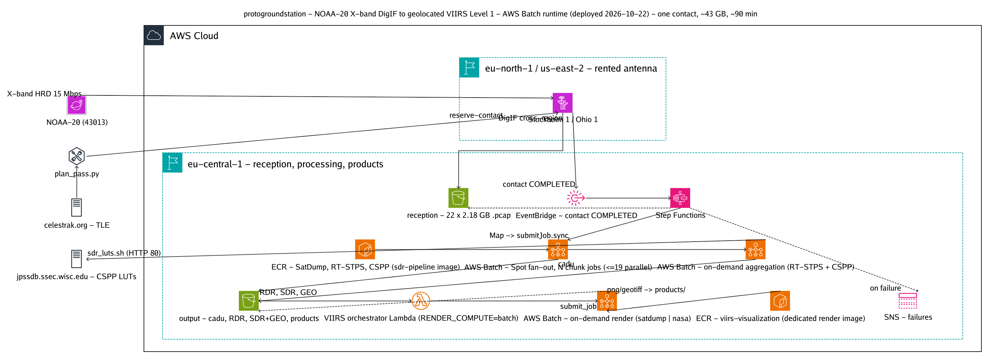
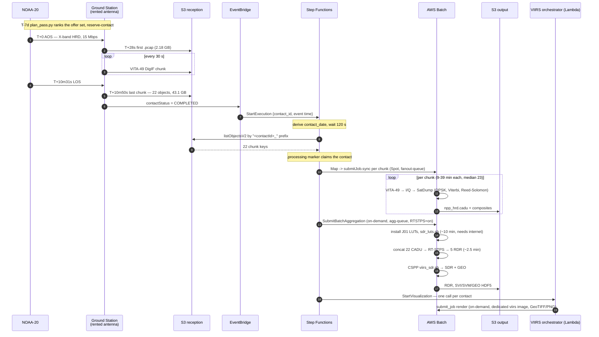
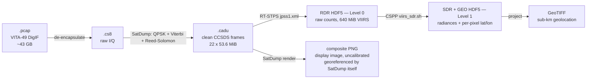

# Architecture

How a booked satellite contact becomes calibrated, geolocated imagery — the services, the
sequence, and the constraints that shaped both.

> New to the domain vocabulary (DigIF, CADU, RDR, SDR, VIIRS, demod/decode, granule...)?
> See [`GLOSSARY.md`](GLOSSARY.md) for the single reference.

Diagram source: [`diagrams/architecture.yaml`](diagrams/architecture.yaml), rendered with
[awsdac](https://github.com/awslabs/diagram-as-code) — `awsdac docs/diagrams/architecture.yaml -o docs/diagrams/out/architecture.png -f`.

Everything inside the cloud boundary is managed. The three things outside it are the ones
AWS does not supply: the **orbital model** that decides which contact is worth buying
(`scripts/plan_pass.py`), the **TLE** it propagates, and the **CSPP calibration LUTs** that
turn raw counts into physical radiances.

Everything below describes the DigIF reception path (`enable_sdr_pipeline`), the one that
has actually flown. Since 2026-10-22 its runtime compute runs on **AWS Batch**, not
CodeBuild (the chunk fan-out, the aggregation, and the visualization render were all
migrated off CodeBuild per ADR-002 / the `clean-compute-pipeline` spec;
`enable_batch_compute = true`). The CodeBuild projects are retained only as a strangler
fallback behind feature flags. A second, live demod/decode path exists alongside it — see
[`SYNC_PIPELINE.md`](SYNC_PIPELINE.md) — but it **cannot currently be flown**: NOAA-20 is
not onboarded for demod/decode on this account (zero schedulable windows), see
[`SYNC_ONBOARDING_INVESTIGATION.md`](SYNC_ONBOARDING_INVESTIGATION.md).

---

## The cinematic — one contact, end to end

Times are relative to AOS, measured on contact `ba2c5446` (2026-08-31, Stockholm 1,
10m31s). Total wall-clock from AOS to Level 1 is roughly **100 minutes**, of which the
pass itself is ten.

### Where the time goes

| Stage | Duration | Note |
|---|---|---|
| Contact | ~10 min | the only part that costs antenna time (~$110) |
| Delivery settle | 120 s | last chunk landed 19 s after LOS; the wait is margin |
| Chunk fan-out | ~40 min | N Batch Spot jobs, up to 19 concurrent; measured 8.7 / 23.3 / 38.9 min (min / median / max). (CodeBuild-era wall-clock; Batch removes the account build-cap throttle.) |
| Aggregation | ~15 min (cache hit) / ~25 min (miss) | on-demand Batch job; PERF-1: `sdr_luts.sh` (~10 min) skipped when LUT DB staged from S3; fallback fetch runs only on first contact after cache is cold |

---

## The processing chain

Each step strips a container or adds meaning; nothing is thrown away until the end.

The lower branch is what open source gives you: display imagery, georeferenced by
SatDump's own scan model. The upper branch is why the NASA stack is still worth the
trouble — calibrated physical radiances and terrain-corrected per-pixel coordinates,
rather than a raytrace of the nominal scan geometry. See [`../articles/article-2-nasa-software.md`](../articles/article-2-nasa-software.md).

---

## Step Functions state machine

`groundstation-noaa20-sdr-pipeline`, defined in
[`../infra/modules/sdr_pipeline/step_functions.tf`](../infra/modules/sdr_pipeline/step_functions.tf).

| State | Type | Purpose |
|---|---|---|
| `DeriveDateOnly` → `DeriveDateParts` → `BuildContactDate` | Pass | event timestamp → `2026/09/06`; three states because Step Functions rejects deeply nested intrinsics |
| `WaitForDelivery` | Wait | 120 s, so the last chunk has landed |
| `ListChunks` | Task | `s3:listObjectsV2` prefixed `"<contactId>_"` |
| `ShapeInput` | Pass | normalise to `{contact_id, bucket, contact_date, chunks[]}` |
| `CheckChunksFound` | Choice | fail loudly on an empty contact |
| `CheckProcessingMarker` / `WriteProcessingMarker` | Task | idempotence via `contacts/{id}/.processing` |
| `ParallelProcessing` | Map | up to 19 concurrent, `ToleratedFailurePercentage: 100`; each item is `SubmitBatchChunk` (`:::batch:submitJob.sync`, Spot `...-fanout-queue`, `...-chunk` job def) |
| `CheckResults` | Pass | normalise the Map output (the former CodeBuild aggregation poll-loop states were retired in the Batch cutover) |
| `SubmitBatchAggregation` | Task | `:::batch:submitJob.sync` — on-demand `...-agg-queue`, `...-aggregation` job def, `RTSTPS=on` (RT-STPS + CSPP) |
| `StartVisualization` | Task | invokes the VIIRS orchestrator Lambda directly — one call per contact. The Lambda dispatches an AWS Batch `...-render` job (`RENDER_COMPUTE=batch`). Catches `States.ALL` to `NotifyVisualizationFailed` (SNS) then succeeds: products are already in S3, so a visualisation failure must not fail the run |
| `NotifyVisualizationFailed` | Task | publish the visualization error to SNS, then proceed to success |
| `MarkAggregationFailed` → `AggregationFailure` | Pass/Task | populate `$.error`, publish to SNS |

**A green execution does not mean 22 good chunks.** The Map tolerates 100 % failure by
design, so partial results still reach aggregation. Check the per-chunk `build_status`.

**A green execution does not mean imagery either.** `StartVisualization` catches to
success, so a failed rendering leaves `products/{date}/{contact}/` empty while the
execution reports `SUCCEEDED`. Three rehearsals did exactly that on 2026-09-01. Verify
against the products prefix, never the execution status.

---

## Constraints worth knowing before changing anything

- **CSPP needs the internet.** `sdr_luts.sh` fetches ancillary/LUT data from
  jpssdb.ssec.wisc.edu (HTTP, port 80) and will time out without egress. Aggregation runs as
  an on-demand **AWS Batch** job whose compute environment security group opens 80 + 443
  egress for exactly this (`infra/modules/batch_compute/main.tf`). This is why aggregation
  was *originally* placed on CodeBuild (the standalone EC2 aggregation instance was
  SSM-outbound-only with no internet); the Batch on-demand CE replaced that reason.
  See [`DEPLOYMENT.md`](DEPLOYMENT.md).
- **The trigger is per contact, not per object.** A pass writes ~22 objects over ~10
  minutes; an execution started by the first cannot know the full list.
- **S3 allows one notification configuration per bucket.** Two `aws_s3_bucket_notification`
  resources on one bucket silently erase each other — that is how EventBridge ended up
  disabled and a whole pass went unprocessed.
- **The contact id is in the object *name*, not a path segment:**
  `year=Y/month=M/day=D/satellite=<sat>/<contactId>_<ts>_<uuid>.pcap`.
- **Re-running a contact accumulates products.** RDR and SDR filenames embed a creation
  timestamp, so they never overwrite; only `.cadu` does.
- **Render runs on AWS Batch; the CodeBuild buildspecs are a retained fallback.** As of
  2026-10-22 the VIIRS orchestrator Lambda dispatches an AWS Batch `...-render` job
  (`RENDER_COMPUTE=batch`) that runs the image-baked `scripts/viirs/render_entrypoint.sh`
  (`RENDER_BRANCH=satdump|nasa`) on the **dedicated `...-viirs-visualization` image**. The
  inline `SATDUMP_BUILDSPEC` / `NASA_BUILDSPEC` in
  [`lambdas/viirs_visualizer/handler.py`](../lambdas/viirs_visualizer/handler.py) and the
  `NO_SOURCE` CodeBuild project are retained only as the strangler fallback
  (`RENDER_COMPUTE=codebuild`) until the Batch render path is proven over several real
  contacts (then retired per task 13). The `buildspecs/viirs_*.yml` files are manual-run
  copies. Three defects once hid in the Lambda/buildspec gap until 2026-09-01: a wrong
  script path, the NASA path reading `chunks/` instead of `sdr/` under pre-J01 filenames,
  and a SatDump sync that produced a nested tree the non-recursive composite discovery could
  not see — all since relocated into `render_entrypoint.sh`.
- **SatDump could georeference its own composites, but not at 1.2.2 (parked 2026-09-02).** It ships the VIIRS scan
  model (`resources/projections_settings/jpss1_viirs.json` — aggregation zones in
  `forced_gcps_x`, 112° scan, `roll_offset` -0.05, `yaw_offset` 0.15) and holds the
  per-scan timestamps inside the product, so it raytraces every line with the right
  pointing. Adding a `project` block to a composite in `satdump_cfg.json` makes it
  write `rgb_<name>_projected.tif`, an equirectangular GeoTIFF; that is done at image
  build time by [`docker/sdr-pipeline/enable_satdump_projection.py`](../docker/sdr-pipeline/enable_satdump_projection.py),
  and `scripts/viirs/projected_reader.py` reads them. The GeoTIFF carries its own
  extent, so nothing downstream needs to know any geometry. **That script is not
  run by the Dockerfile**: at 1.2.2 the composite path resolves 0 GCPs and
  segfaults ([SATDUMP.md](SATDUMP.md)). Until a SatDump upgrade fixes it, the
  fallback below is the active path — `projected_reader` simply finds no files
  and says so in the log.
- **SatDump needs a TLE, and its own updater cannot reach CelesTrak from CodeBuild.**
  Composites decode without one, so `0 TLEs loaded!` sat in every chunk log for months
  harmlessly; projection then resolves every control point to the same place, collapses
  the bounds to the whole globe and segfaults on a 32000×16000 allocation.
  `scripts/satdump_process.sh` passes `--tle_override`, which loads a specific file and
  skips the network update entirely. Details in [SATDUMP.md](SATDUMP.md).
- **`scripts/viirs/scan_geometry.py` is the active geolocation path**, and a fallback only
  in intent: it is what runs while SatDump's own projection is parked. It reconstructs SatDump's model from outside
  and is less accurate: it cannot apply the roll/yaw corrections, and it rebuilds line
  times from a rate where SatDump has the real per-scan timestamps. Three things in it
  are still worth knowing, because they are documented nowhere: the CBOR ephemeris
  timestamps are 2³² s low; the frame they describe was rotated with that *wrapped*
  clock, so undoing it needs the raw stamp; and the composite is cropped relative to
  the bands whose timestamps it carries. Do not extend it — fix the SatDump config.
- **SatDump output is per chunk, not per contact.** Composites live at
  `satdump/chunk_N/<INSTRUMENT>/`, one set per 30 s of downlink. `chunk_0` is the first
  30 s after AOS. The visualiser globs a flat directory, so the buildspec stages the
  per-chunk folders into one, lowest chunk number winning.
- **Visualisation is told, not triggered.** It was once driven by an S3 `ObjectCreated` rule
  matching `.png`; a contact writes ~9,150 objects, so arming that bucket produced ~6,000
  CodeBuild builds in a morning and exhausted the account build queue. Nothing this pipeline
  writes is one-per-contact, so no filter fixes it — the state machine calls the orchestrator.
- **The SDR image is built by an IaC CodeBuild project, `groundstation-noaa20-sdr-docker-build`.**
  The old out-of-band project `satdump-noaa20-processing` (role `codebuild-satdump-role`)
  that predated it was **deleted on 2026-10-22** (orphaned, not in Terraform, superseded by
  the IaC image-build project and the Batch fan-out — see
  [`SYNC_ONBOARDING_INVESTIGATION.md`](SYNC_ONBOARDING_INVESTIGATION.md) history and the
  `codebuild_image.tf` note). The IaC project (`infra/modules/sdr_pipeline/codebuild_image.tf`)
  builds the SatDump/RT-STPS/CSPP image and pushes it to the sdr-pipeline ECR repo. The
  dedicated VIIRS image is built by a separate IaC project,
  `groundstation-noaa20-viirs-docker-build`. **Image-build gotcha:** both image-build
  projects build from GitHub `sourceVersion = main`, so code must be merged to `main` before
  a rebuild carries it into the image (a container Batch job runs image-baked code). See the
  handoff's CRITICAL note.

- **The EC2 aggregation instance carries a hand-installed `/opt/rt-stps` and
  `/opt/SDR_4_1`** that exist in no Terraform, Dockerfile or user_data. Replacing the
  instance destroys them, which is why `ignore_changes` covers `root_block_device`.
  Drift is now **DETECTED** (OE-2): an SSM State Manager association
  (`infra/modules/sdr_pipeline/ssm_drift_check.tf`) runs a daily presence-and-non-empty
  check on these paths and emits an `OptDriftDetected` metric (namespace `SDRPipeline`,
  dimension `InstanceId`) to CloudWatch; `monitoring.tf` alarms on it and routes to SNS.
  The same detection covers the sync receiver's `/opt/rt-stps` + `config/jpss1.xml`
  (namespace `SyncPipeline`, `infra/modules/sync_pipeline/ssm_drift_check.tf`). Full
  automated reconstruction from vendor tarballs remains **DEFERRED** — the CSPP/RT-STPS
  install is weeks of manual work; re-encoding it blind risks silent wrongness that only
  surfaces during a pass.

---

## Cost per contact

| Item | Approx. |
|---|---|
| Antenna time (10 min, on-demand) | $110–130 — the dominant cost |
| Compute: AWS Batch — Spot fan-out (idempotent chunks) + one on-demand aggregation + one on-demand render | ~$1–2 (ADR-001 Option C; Spot for the restartable fan-out). Formerly CodeBuild ~490 build-minutes. |
| Cross-region transfer (43 GB) | ~$1 |
| S3 storage | ~$1/month per retained pass |

DigIF delivery is the reason the numbers are this size: it ships ~30× the demodulated
bitstream. AWS also offers demodulated delivery — cheaper, if implementing the signal chain
is not the point.

---

## Accepted architectural tradeoffs

Deliberate decisions, recorded so a reviewer does not mistake a conscious choice for an
oversight. Each is a demonstrator-appropriate trade with a documented rationale; the
Well-Architected refinement ([`ARCHITECTURE_REFINEMENT.md`](ARCHITECTURE_REFINEMENT.md))
assessed each and chose to keep it rather than engineer it away.

| Decision | Rationale | Where it lives | Revisit when |
|---|---|---|---|
| **Single-region, no cross-region DR** | A demonstrator; the system of record is Partner Central/Ground Station, and S3 is a replayable cache. Cross-region replication adds cost without protecting anything irreplaceable. | `checkov:skip=CKV_AWS_144` on every output bucket (`s3.tf`) | This becomes a production dependency with an RPO/RTO requirement. |
| **Single shared KMS CMK across all domains** | One key for S3/ECR/CloudTrail/SNS/Logs/EBS across both pipelines. Operational simplicity over blast-radius isolation; rotation is enabled and the key policy is least-privilege per service principal. | `aws_kms_key.groundstation` (`security/main.tf`) | A compliance boundary requires per-domain key separation, or a second tenant shares the account. |
| **Sync receiver single-AZ** | The receiver is one instance in `subnets.ids[0]`. The fixed-IP ENI (REL-6) and the PREPASS readiness check (REL-5) address the realistic failure modes; multi-AZ would not help a per-contact, pre-positioned receiver and doubles idle cost. | `aws_instance.receiver` (`sync_pipeline/ec2.tf`) | The sync path becomes the primary (non-experimental) reception mode. |
| **Scheduler cron disabled** | Automatic booking once reserved two unintended paid contacts. Reservation is now a deliberate human act, backed by the Task 11 budget guardrail. | `contact_scheduler` (cron disabled); budget in `security/budget.tf` | Booking is driven by a reviewed, rate-limited automation with its own spend guard. |
| **`ToleratedFailurePercentage = 100` on the chunk Map** | Partial chunk results are still useful — aggregation consumes whatever decoded. Kept, but made *visible* by the `ChunksSucceeded`/`ChunksFailed` metrics + all-chunks-failed alarm (REL-3). | `ParallelProcessing` Map (`sdr_pipeline/step_functions.tf`); metrics in `monitoring.tf` | — (visibility added; behaviour intentionally retained). |
| **Account-wide budget (not GS-service-scoped)** | A working account-wide ceiling beats a budget mis-scoped to a Cost Explorer service name not yet verified. A ready-to-enable `cost_filter` is committed, commented. | `aws_budgets_budget.ground_station` (`security/budget.tf`) | The exact Cost Explorer "AWS Ground Station" service string is confirmed. |

### The buildspec-override contract (OE-3) — historical, now superseded by Batch

This contract applied to the CodeBuild runtime, which has been migrated to AWS Batch
(2026-10-22). It is retained here as history and because the CodeBuild render path survives
as a flag-gated fallback:

- `aws_codebuild_project.sdr_pipeline` — the shared fan-out + async-aggregation project was
  **retired** in the Batch cutover (task 8). The Map now runs `SubmitBatchChunk` and
  aggregation runs `SubmitBatchAggregation` (`scripts/aggregation_entrypoint.sh`, fetched
  from `s3://.../software/`). `buildspecs/aggregation.yml` is no longer read by Terraform.
- `aws_codebuild_project.viirs_visualization` — still `NO_SOURCE`; its inline
  `SATDUMP_BUILDSPEC` / `NASA_BUILDSPEC` override (from `lambdas/viirs_visualizer/handler.py`)
  is now the **fallback** path only. The live render runs on Batch via
  `scripts/viirs/render_entrypoint.sh`.

Where a CodeBuild stub survives it **fails safe with `exit 1`** (a standalone run without an
override is a misconfiguration and must error loudly). `tests/test_buildspec_contract.py`
still guards that invariant. Three real defects once hid in the gap between the stub and the
real buildspec (2026-09-01); the guard exists so that class of error cannot recur silently.
