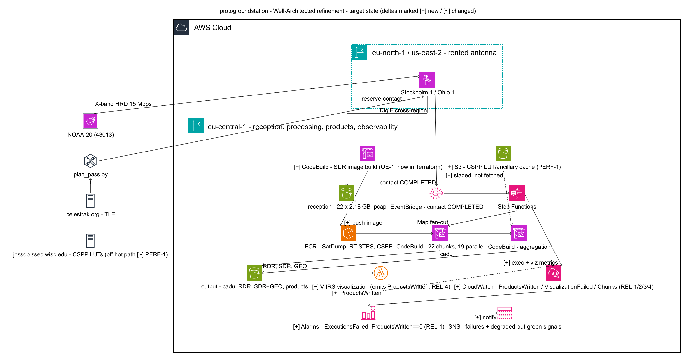

# Architecture Refinement — Well-Architected Target

A ground-up, Well-Architected restatement of the protogroundstation pipeline, and the
concrete deltas from what is deployed today. This is a design record, not a rewrite order:
every delta below is traceable to a confirmed fact in the current Terraform/handler code,
and each is scoped so it can be implemented and verified independently.

> **Companion documents.** This refinement does not replace [`ARCHITECTURE.md`](ARCHITECTURE.md)
> (the as-built async DigIF path) or [`SYNC_PIPELINE.md`](SYNC_PIPELINE.md) (the demod/decode
> path). It states the *target* and the *gap*. The execution plan lives in the spec
> [`.kiro/specs/architecture-refinement/`](../.kiro/specs/architecture-refinement/).

Target-state diagram (deltas marked `[+]` new / `[~]` changed; source
[`diagrams/architecture-refinement.yaml`](diagrams/architecture-refinement.yaml), rendered with
awsdac):

---

## Design principles (unchanged — these already hold)

The current system gets the hard things right, and the refinement keeps them:

1. **The whole loop is code** — feasibility, planning, booking, reception, processing.
2. **S3 is the source of truth** for the async path; the pipeline is a replayable function
   of what landed in the reception bucket. Idempotence via the `.processing` marker.
3. **Orchestration is contact-level, not object-level** — Ground Station Contact State
   Change events, never per-S3-object notifications (the ~6,000-build incident is why).
4. **Deliberate, human-gated booking** — the scheduler cron stays disabled; reserving a
   paid contact is an explicit act.
5. **Honest runbooks** — the `docs/` record of *why*, including failures, is a first-class
   artifact. Every delta here must leave the runbook truer, not just the code.
6. **Published Terraform modules over hand-rolled** wherever one fits (per `CLAUDE.md`),
   hand-rolling only Ground Station-specific or project-least-privilege resources.

---

## The one organising idea of the refinement

Today's weaknesses cluster into exactly two themes. Everything below is one or the other:

- **Drift from IaC** — load-bearing resources that `terraform apply` can neither create
  nor repair (the SDR-image CodeBuild project; the hand-installed `/opt/*` software on both
  EC2 instances).
- **Success is inferred, not observed** — a `SUCCEEDED` execution proves neither good chunks
  nor imagery, and the async pipeline emits no failure signal at all. Operators verify by
  hand against the `products/` prefix.

A Well-Architected version eliminates the first and closes the second. The pillar sections
below are organised around that.

---

## Operational Excellence

### Target
Every load-bearing resource is provisioned and repairable by `terraform apply`. Software
dependencies live in version-controlled artifacts (container image layers or codified
provisioning), never as un-codified mutations to a running instance. Pipeline outcome is a
first-class, queryable signal.

### Deltas from today

| # | Finding (confirmed) | Target state |
|---|---|---|
| OE-1 | SDR-image CodeBuild project `satdump-noaa20-processing` exists in **no** Terraform; `sdr_pipeline` defines only the `NO_SOURCE` stub runner. A read-only S3 statement was hand-added to its role on 2026-09-01. | Codify the image-build CodeBuild project + its scoped IAM in `sdr_pipeline` (mirroring the pattern `viirs_visualization/codebuild.tf` already uses for `viirs_docker_build`). `terraform apply` creates and repairs it. |
| OE-2 | Both EC2 instances carry hand-installed `/opt/rt-stps` + `/opt/SDR_4_1` (and the sync receiver's patched `jpss1.xml`), guarded by `ignore_changes = [root_block_device]` and no `user_data`. Replacing a volume silently destroys them. | Move the install into a codified, reproducible step: either (a) `user_data` / an SSM Document / Image Builder recipe that reconstructs `/opt/*` from the vendor tarballs in S3, or (b) accept the manual install but **codify it as an SSM State Manager association** so drift is detectable. Either way, remove the "silent destruction" failure mode. |
| OE-3 | The real visualization buildspecs live as string constants in `lambdas/viirs_visualizer/handler.py`; the CodeBuild project is a `NO_SOURCE` stub that exits 1. | Acceptable pattern (keeps spec + runtime args together), but **document the contract explicitly** and add a test asserting the stub never runs standalone. No infrastructure change; close the knowledge gap that hid three defects until 2026-09-01. |

---

## Security

### Target
Least privilege everywhere permissions can be scoped; wildcard only where the AWS action is
genuinely not resource-scopeable, and then documented. Audit coverage sufficient to answer
"who did what to the data," not only "who called the management API."

### Deltas from today

| # | Finding (confirmed) | Target state |
|---|---|---|
| SEC-1 | `processor_lambda` grants `cloudwatch:PutMetricData` on `Resource = "*"` with **no** `cloudwatch:namespace` condition (`security/main.tf`, `enable_processing_pipeline` only). The sdr/sync equivalents **are** namespace-conditioned. | Add the same `StringEquals { "cloudwatch:namespace" = ... }` condition. Brings the one unconditioned PutMetricData into line. |
| SEC-2 | `viirs_visualization/iam.tf` CodeBuild policy uses `Action = "logs:*"` (resource-scoped to the viirs log group, but the full verb wildcard) where every other module uses the three write actions. | Narrow to `logs:CreateLogGroup`, `logs:CreateLogStream`, `logs:PutLogEvents`. |
| SEC-3 | The out-of-IaC SDR-image build role is privileged and had a hand-edited S3 statement. | Resolved by OE-1 — codifying the project puts its role under review and Checkov. |
| SEC-4 | CloudTrail is single-region, management-events-only; its S3 bucket is `force_destroy = true` with no versioning/lifecycle, weaker than the pipeline buckets it audits. | Decide deliberately: for a demonstrator, document the single-region management-only choice as an accepted tradeoff (like the no-DR skips), **and** harden the trail bucket (versioning on, drop `force_destroy`, object-lock or MFA-delete optional). Audit log integrity should not be weaker than the data it audits. |

> **Not gaps** (confirmed, keep as-is, documented): `ecr:GetAuthorizationToken` on `*`,
> `ssm:GetCommandInvocation` on `*`, `ec2:Describe*` / `ssm:DescribeInstanceInformation` on
> `*`, the CloudWatch Logs delivery-management block, and the KMS `kms:*`-to-root statement
> are all either un-scopeable AWS actions or standard patterns.

---

## Reliability

### Target
Every pipeline outcome is detectable without human inspection. Degraded-but-green states
(partial chunk failure, swallowed visualization failure) raise an explicit signal. The
synchronous path's single points of failure are either removed or alarmed *before* a pass
is lost, not after.

### Deltas from today

| # | Finding (confirmed) | Target state |
|---|---|---|
| REL-1 | `sdr_pipeline` has **no** `monitoring.tf` and zero CloudWatch alarms — no `ExecutionsFailed` alarm, no aggregation-Lambda-error alarm, no success metric. Only `sync_pipeline` has alarms. | Add `sdr_pipeline/monitoring.tf`: `AWS/States ExecutionsFailed` alarm on the state machine, Lambda-error alarms on the orchestrator + aggregation trigger, all → the existing shared SNS topic. Parity with the sync path. |
| REL-2 | `StartVisualization` catches `States.ALL → success` by design, so a *systematically* broken visualization produces no signal; the orchestrator returns `build_id: None` and only logs a WARNING on `NoVisualizableDataError`. | Keep the catch (products must survive a render failure) **but** emit an explicit signal: on the catch path, publish a custom metric (e.g. `VisualizationFailed`) and an SNS notification. The pipeline still reports success; the *failure* becomes observable and alarmable. |
| REL-3 | The Map sets `ToleratedFailurePercentage = 100`; `CheckResults` always proceeds. An all-chunks-failed contact still reaches aggregation with no metric. | Emit a `ChunksSucceeded` / `ChunksFailed` metric from the Map result; alarm when the success ratio drops below a threshold. Keep the 100% tolerance (partial results are still useful) — just make degradation visible. |
| REL-4 | Custom metric namespaces `SDRPipeline` / `SyncPipeline` are permissioned but may be **empty** — nothing confirmed to emit `put-metric-data`. | Make the "products written" signal real: the visualization CodeBuild buildspec emits `ProductsWritten` in its `post_build` phase, after `aws s3 sync`, so the count reflects actual files uploaded by the build (not the empty prefix seen at Lambda dispatch time). The CodeBuild service role requires `cloudwatch:PutMetricData` conditioned on `cloudwatch:namespace=SDRPipeline`. |

### Synchronous path (highest residual risk)

| # | Finding (confirmed) | Target state |
|---|---|---|
| REL-5 | No S3 buffer: a missed arm = lost pass. Pre-AOS timing race (arm Lambda 420 s; two SSM/EC2 polls can consume ~360 s). Arming is fire-and-forget — no verification the listener bound, packets arrive, or the packet format matches. | Treat first-contact packet-format validation as a **gate** before relying on this path. Add a cheap raw-capture tee to S3 so a decode failure is replayable. Add a *preventive* readiness signal: verify listener bind + first-packet arrival and alarm during PREPASS, not only after LOS. |
| REL-6 | The dataflow endpoint group is pinned to `aws_instance.receiver.private_ip`; stop/start automation can change the IP and silently break the binding. | Pin to a stable address — a secondary ENI with a fixed private IP attached to the receiver, referenced by the endpoint group — so start/stop cannot move it. |
| REL-7 | Single instance, single AZ (`subnets.ids[0]`), auto-recovery alarm only. | Document the single-AZ choice as an accepted demonstrator tradeoff; the ENI-pinning (REL-6) and preventive readiness check (REL-5) matter more than multi-AZ for this workload. |

---

## Performance Efficiency

### Target
The ~10-minute `sdr_luts.sh` ancillary fetch is not on the critical path of every contact,
and does not depend on reaching the public internet at run time.

### Deltas from today

| # | Finding | Target state |
|---|---|---|
| PERF-1 | Aggregation runs in CodeBuild specifically because CSPP's `sdr_luts.sh` needs internet; the fetch costs ~10 min/contact. | Cache the ancillary/LUT set in S3 and stage it into the build, refreshed by a scheduled job rather than fetched per contact. Trades a maintenance task for ~10 min of hot-path latency and removes a run-time internet dependency. **Note: this removes the original reason aggregation had to run in CodeBuild — see open decision OPEN-1.** |
| PERF-2 | Chunk fan-out is 19 concurrent across 22 chunks (~40 min). | Sound fit for the window as a shape; but *whether CodeBuild is the right compute* for it is not settled — see OPEN-1. |

---

## Cost Optimization

### Target
Paid actions are guarded; the expensive delivery mode is a deliberate per-contact choice.

### Deltas from today

| # | Finding | Target state |
|---|---|---|
| COST-1 | Scheduler cron disabled after it booked two unintended paid contacts. | Keep disabled. Optionally add a hard guardrail: a budget alarm and/or an approval step in front of `reserve-contact` so an accidental enable cannot silently spend. |
| COST-2 | DigIF ships ~30× the demodulated bitstream; the sync (demod/decode) path exists to attack this. | No change to the design — both paths exist and are chosen per contact by mission-profile ARN. The refinement's REL-5/REL-6 work is what makes the cheaper path trustworthy enough to prefer. |

---

## Open architectural decisions (tradeoff studies, not yet decided)

These are genuine design questions the refinement surfaces but does **not** silently answer.
Each needs a short tradeoff study with real numbers before a direction is chosen. They are
tracked as decisions, not backlog tasks, because picking wrong is more expensive than the
delta tasks above.

### OPEN-1 — Is CodeBuild the right compute for chunk fan-out and aggregation?

**Why this is open.** CodeBuild is a CI/CD *build* service being used as a *batch compute
engine* — 490+ build-minutes per contact across 22 concurrent `BUILD_GENERAL1_2XLARGE`
builds. It landed here for one reason: CSPP's `sdr_luts.sh` needs internet and the
SSM-outbound-only EC2 aggregation instance couldn't reach it (`docs/DEPLOYMENT.md`). The
chunk fan-out then inherited the same project. Two things make this worth re-examining now:

1. **PERF-1 removes the original constraint.** Once the LUT/ancillary set is cached in S3,
   nothing in aggregation needs the public internet — so "it had to be CodeBuild" no longer
   holds.
2. **Cost.** `docs/ARCHITECTURE.md` already names CodeBuild as "the largest variable" cost.
   Per-build-minute pricing on 2XLARGE × 22 concurrent is a poor fit for restartable batch work.

**Options to weigh (with real per-contact cost + wall-clock, not guesses):**

| Option | Fit | Cost lever | Cost of change |
|---|---|---|---|
| **Keep CodeBuild** (status quo) | Works today; simplest | None | Zero — but leaves the mismatch |
| **AWS Batch on Fargate** | Purpose-built for container fan-out | Right-sized vCPU/mem | Medium — Step Functions already orchestrates |
| **AWS Batch on EC2 Spot** | Batch-native + cheapest for restartable chunks | Spot (chunks are idempotent, Map already tolerates failure) | Medium–high |
| **ECS/Fargate tasks via Step Functions** | Batch-native, same container image | On-demand/Spot Fargate | Medium |
| **EC2 + LUT cache** | The original intent, viable again post-PERF-1 | Reserved/Spot EC2 | Low–medium (instance already exists) |

**Recommendation:** do PERF-1 first (it is a prerequisite that de-risks every alternative),
then run the study. The Map's existing `ToleratedFailurePercentage = 100` and the chunks'
idempotence make **Spot-backed batch** the strongest a-priori candidate for the fan-out, but
that must be confirmed with measured numbers before committing. This decision is explicitly
**not** made by this refinement — it is raised so it is decided deliberately.

> **Resolved as ADR-001** (see end of document): recommends AWS Batch on EC2 Spot for the
> fan-out, gated on PERF-1 landing and one measured bake-off before any migration spec. The
> study found the real driver is not cost (compute is dwarfed by antenna time) but the measured
> CodeBuild concurrency throttle and tool-fit.

> This open decision exists because the first pass of the refinement treated "keep CodeBuild"
> as a given. It is not a given; it is the single largest cost lever in the pipeline.

---

Priority reflects blast radius × likelihood, grounded in the incidents already in the record.

| Pri | ID | One-line | Pillar |
|---|---|---|---|
| 1 | OE-1 | Codify the SDR-image CodeBuild project + IAM | Ops / Sec |
| 1 | REL-4 | Emit a real `ProductsWritten` success signal | Reliability |
| 2 | REL-1 | Add `sdr_pipeline` alarms (parity with sync) | Reliability |
| 2 | REL-2 | Make swallowed visualization failure observable | Reliability |
| 2 | OE-2 | Remove the `/opt/*` silent-destruction failure mode | Ops |
| 3 | REL-5 | De-risk the sync path (packet gate, raw tee, PREPASS readiness) | Reliability |
| 3 | SEC-1 | Scope `processor_lambda` PutMetricData | Security |
| 3 | SEC-2 | Narrow viirs CodeBuild `logs:*` | Security |
| 4 | REL-3 | Chunk success/failure metric | Reliability |
| 4 | SEC-4 | Harden CloudTrail bucket; document trail scope | Security |
| 4 | REL-6 | Pin sync dataflow endpoint to a stable ENI | Reliability |
| 5 | PERF-1 | Cache CSPP ancillary/LUTs in S3 (**prerequisite for OPEN-1**) | Performance |
| 5 | COST-1 | Budget/approval guardrail on reserve-contact | Cost |
| 5 | OE-3 | Document the buildspec-override contract + guard test | Ops |

**Open decision (study, not a task):** OPEN-1 — compute platform for fan-out/aggregation
(CodeBuild vs AWS Batch/Fargate/Spot vs EC2). Sequenced after PERF-1. See the open-decisions
section above. This is the largest cost lever and is deliberately left undecided here.

### Explicitly accepted tradeoffs (not backlog — documented decisions)

- Single-region, no cross-region DR (demonstrator; `checkov:skip=CKV_AWS_144` already records this).
- Single shared KMS CMK across domains (operational simplicity over blast-radius isolation).
- Sync receiver single-AZ (ENI-pinning + readiness check matter more here than multi-AZ).
- `ToleratedFailurePercentage = 100` retained (partial chunk results are still useful) — made *visible*, not removed.

---

## How this gets executed

Through the generic **well-architected delta workflow** (steering:
[`.kiro/steering/wa-delta-workflow.md`](../.kiro/steering/wa-delta-workflow.md)), which runs
each backlog item through four agentic quality gates — implement → validate → security-gate
→ review — before it is considered done. The concrete, ordered task breakdown is the spec at
[`.kiro/specs/architecture-refinement/`](../.kiro/specs/architecture-refinement/).

---

## ADR-001 — Compute platform for chunk fan-out and aggregation (resolves OPEN-1)

**Status:** Proposed (decision document — no implementation; any migration is a separate spec)
**Date:** 2026-10-09
**Depends on:** PERF-1 (S3 LUT cache) — the prerequisite that makes every non-CodeBuild option viable
**Deciders:** AWS Alliance / project owner

### Context

The pipeline runs two compute stages on CodeBuild:
- **Chunk fan-out** — up to 27 concurrent `BUILD_GENERAL1_2XLARGE` builds (one per 30 s DigIF chunk), each running VITA-49 → I/Q → SatDump.
- **Aggregation** — one `BUILD_GENERAL1_2XLARGE` build running `sdr_luts.sh` + RT-STPS + CSPP.

CodeBuild is a **CI/CD build service**, not a batch compute engine. It was chosen for one
reason only: CSPP's `sdr_luts.sh` needs outbound internet, and the EC2 aggregation instance
(`r6i.xlarge`, SSM-outbound-only) could not reach it (`docs/DEPLOYMENT.md`). The chunk fan-out
then inherited the same project.

Two facts force a re-examination:
1. **PERF-1 removes the only reason it had to be CodeBuild.** With LUTs cached in S3, no stage
   needs the public internet.
2. **Measured data says the bottleneck is CodeBuild's own concurrency limit, not the workload.**
   From contact #5 rehearsal 3 (`docs/CONTACTS.md`, verbatim): *"Most of the 57 min was CodeBuild
   queue time — the account's concurrent-build limit, not the Map's `MaxConcurrency`, is what
   paces the fan-out."* The pipeline is being throttled by the build service, not by compute.

### Measured inputs (real, from `docs/CONTACTS.md` and the Terraform)

| Input | Value | Source |
|---|---|---|
| Chunks per contact | 17–27 (22 typical) | Contacts #1–#6 |
| Chunk build time | 8.7 / 23.3 / 38.9 min (min/median/max) | `ARCHITECTURE.md` |
| Aggregation time | ~25 min (~10 of it `sdr_luts.sh`) | `ARCHITECTURE.md` |
| Total build-minutes | ~490 / contact | `ARCHITECTURE.md` cost table |
| Dominant delay | CodeBuild **queue** time (concurrency cap) | Contact #5 rehearsal 3 |
| Chunk compute | `BUILD_GENERAL1_2XLARGE` (72 GB / 8 vCPU class) | `codebuild.tf` |
| Current EC2 (idle) | `r6i.xlarge`, 300 GB gp3 | `ec2.tf` |
| Chunk idempotence | Yes — Map tolerates 100% failure, chunks re-runnable | `step_functions.tf` |

### Options evaluated

> **Cost figures below are list-price ESTIMATES for relative comparison, not measured.**
> Acceptance criterion 11.2 requires measured per-contact cost before a migration spec commits;
> this ADR establishes direction and the order-of-magnitude cost structure.

| Option | Batch fit | Concurrency ceiling | Spot? | Est. compute $/contact¹ | Cost of change |
|---|---|---|---|---|---|
| **A. CodeBuild (status quo)** | Poor — build tool as batch engine | Account build cap (the measured bottleneck) | No | ~$7–9 (490 build-min × 2XLARGE) | Zero |
| **B. AWS Batch on Fargate** | Good — container array jobs | Service quota, raisable | Fargate Spot | ~$3–5 on-demand; ~$1–2 Spot | Medium |
| **C. AWS Batch on EC2 Spot** | **Best** — array jobs, bin-packed | Managed compute env, raisable | **Yes (ideal for idempotent chunks)** | **~$1–2** | Medium–high |
| **D. ECS/Fargate tasks via Step Functions** | Good — same image, `ecs:runTask` | Service quota | Fargate Spot | ~$3–5; ~$1–2 Spot | Medium |
| **E. EC2 + LUT cache (original intent)** | Fair — manual scaling | Instance size | Reserved/Spot | ~$2–4 | Low (instance exists) |

¹ Order-of-magnitude only. CodeBuild 2XLARGE ≈ $0.02/min list; Fargate/EC2 figures assume
right-sized 8-vCPU/16–32 GB tasks for the chunk shape and Spot discounts of ~60–70%. Antenna
time (~$110) and cross-region transfer dwarf all of these — **compute is not the dominant
per-contact cost; the mismatch is about fit, concurrency, and operational honesty, not dollars.**

### The honest reframing

The cost delta between options is small against the ~$110 antenna cost. So the decision is
**not** primarily about money — it is about:
- **Removing the throttle.** The measured bottleneck is CodeBuild's account-level concurrent-build
  limit. A batch service with a raisable compute-environment quota lets all chunks run truly
  concurrently, cutting wall-clock materially (the 57 min was mostly queue).
- **Using a tool for its purpose.** Batch array jobs model "N idempotent container runs" natively;
  the 100%-tolerated-failure Map is partly a workaround for build-level failure granularity.
- **Spot for idempotent work.** Chunks are restartable and the Map already tolerates failure —
  the textbook case for Spot, which CodeBuild cannot use.

### Decision

**Recommend Option C (AWS Batch on EC2 Spot) for the chunk fan-out, with aggregation as a
single on-demand Batch job (or kept on CodeBuild until the fan-out migration proves out).**
Rationale: it directly attacks the measured bottleneck (concurrency), is the natural fit for
idempotent container fan-out, and is the only option that unlocks Spot for the restartable
chunk work. Fargate (B/D) is the fallback if EC2 Spot capacity for the required instance shape
proves unreliable in `eu-central-1`.

**This decision is explicitly gated on two things before any implementation:**
1. **PERF-1 must land first** (removes the internet dependency).
2. **One measured bake-off** — run a single contact's chunks through a Batch-on-Spot compute
   environment and record real $/contact and wall-clock, to replace the estimates above.

Only then does a **separate migration spec** get written. This ADR does not authorise the
migration; it authorises the bake-off and records the direction so the choice is deliberate.

### Consequences

- **Positive:** removes the throttle, right tool for the shape, Spot savings, batch-native retry.
- **Negative:** more infrastructure than "a CodeBuild project" (compute environment, job queue,
  job definitions); Spot interruptions must be handled (mitigated — chunks are idempotent).
- **Neutral:** the container image is unchanged — all options run the same ECR image.

### What this ADR deliberately does NOT do

It does not pick Fargate-vs-EC2 finally (the bake-off decides), does not migrate aggregation
pre-emptively, and does not touch the sync pipeline's CSPP-only CodeBuild step (out of scope).

---

## Vendor Notifications Inbox

### CSPP mailing list — S-NPP data cessation notice (2026-10-01)

**Source:** cspp_registrants@g-groups.wisc.edu (CIMSS/UW-Madison SSEC CSPP registration &
announcement list).
**Subject:** "Administrative Update #1 — Cessation of Suomi National Polar-orbiting Partnership
(S-NPP) data to users on/after November 02, 2026 — Issued October 1, 2026 1828 UTC."

> **Correction (2026-10-12):** an earlier version of this note recorded this email as "blank
> (zero-width space), accidental/test send, no action required." **That was wrong on both
> counts** — a content-extraction artifact (`U+200B`) was mistaken for an empty message, and
> the "no action" conclusion was an assumption written as a finding. The real content is a
> 30-day NOAA notice. Recorded here in full because the error is exactly the "filtering on a
> field that happens to be absent" trap this document warns against elsewhere.

**What the notice says:** NOAA will **permanently** end delivery of all remaining S-NPP science
products at **2026-11-02 13:00 UTC**. Impacted: ATMS, CERES, OMPS (Nadir + Limb), VIIRS, and —
notably — **HRD Direct Broadcast will be disabled**. (CrIS operational use already ended
2025-12-23.)

**Impact on this project — assessed against the actual code, not assumed:**

| Question | Finding |
|---|---|
| Which satellite does this pipeline fly? | **NOAA-20 (JPSS-1), NORAD 43013** — hardcoded throughout (`scripts/geolocation.py`, `bbox_calculator.py`, `satdump_process.sh`, CelesTrak `CATNR=43013`), RT-STPS `jpss1.xml`, CSPP `_j01_` tokens, `satdump npp_hrd` (a pipeline *name*, not the S-NPP spacecraft). |
| Does the cessation target NOAA-20? | **No.** It targets **S-NPP (NORAD 37849)**, NOAA-20's predecessor — a *different* satellite. `npp.xml` appears in the repo only as the config we deliberately do **not** use. |
| Direct exposure to the pipeline flying today? | **None.** No contact, mission profile, or processing path depends on S-NPP. NOAA-20 HRD Direct Broadcast is unaffected by an S-NPP-specific DB shutdown. |

**So why keep this (it is not "no impact"):**
1. **It is a precedent and a timeline.** S-NPP (launched 2011) is being retired; NOAA-20
   (launched 2017) is next-oldest in the JPSS series. A JPSS-wide DB cessation notice for
   NOAA-20 would arrive on **this same list, in this same format**. The channel is now known to
   carry mission-ending notices — monitoring it is no longer optional hygiene, it is how we
   would learn the pipeline's own satellite is being switched off.
2. **"HRD Direct Broadcast disabled" is the exact capability this pipeline consumes.** For
   S-NPP it is already scheduled. We should know NOAA-20's HRD DB end-of-life date; it bounds
   the useful life of the entire async DigIF pipeline. **Action: find NOAA-20's HRD DB
   sunset date** (JPSS program / NOAA OSPO) and record it as a hard horizon in `docs/CONTACTS.md`.
3. **No code change, no spec change.** Nothing to patch today. This is a strategic-lifetime
   fact, not a defect.

**Process learning (backported):** do not record an un-extractable email body as "blank / no
action." If the body does not render, read the **subject line and attachments** before drawing
any conclusion — the signal is often there. Mistaking absent-extraction for absent-content is
the same class of bug as filtering on a field that is merely missing.

---

## ADR-002 — Whole-pipeline compute platform: remove CodeBuild from the runtime (extends ADR-001)

**Status:** Accepted (direction) — implementation via spec `clean-compute-pipeline`
**Date:** 2026-10-09
**Extends:** ADR-001 (which decided fan-out only). This ADR widens the decision to **every**
runtime compute stage, both branches, end-to-end to `.png` + `.geotiff` + `.json`.
**Depends on:** PERF-1 (S3 LUT cache) — DEPLOYED. The compute-bakeoff spot measurement is run
as the first implementation step (strangler), not as a separate pre-gate.

### Context — the scope ADR-001 left open

ADR-001 answered one question: *what compute runs the chunk fan-out?* It deliberately did
**not** touch aggregation, visualization render, or the sync path. But the project owner's
standing question across the refinement was broader — *why is CodeBuild in the pipeline at
all?* The honest answer is that "refined pipeline" hardened CodeBuild rather than removing it,
and off-CodeBuild was recorded as an un-executed recommendation. This ADR closes that gap by
deciding the compute platform for the whole pipeline, not one stage.

### Current compute placement (grounded in the Terraform/handlers)

| Stage | Today | Fit problem |
|---|---|---|
| Chunk fan-out (pcap→cs8→SatDump) | CodeBuild 2XLARGE ×19–27 concurrent | CI/CD tool as batch engine; account build-cap is the measured throttle; no Spot |
| Aggregation (RT-STPS + CSPP) | CodeBuild 2XLARGE ×1 | Only chosen because CSPP needed internet — PERF-1 removed that reason |
| Visualization render (both branches) | Lambda fire-and-forget → CodeBuild MEDIUM via `buildspecOverride` | Most tangled stage; buildspecs are string constants in a Lambda; stub project exits 1 standalone |
| Sync RT-STPS live demod | EC2 receiver + SSM | Not batch — consumes a live UDP stream bound to a fixed ENI |
| Sync aggregation (CSPP-only) | CodeBuild 2XLARGE, **no** PERF-1 cache | Duplicate of async aggregation, missing the LUT fast-path |

### Decision — per stage

| Stage | Target compute | Spot? | Rationale |
|---|---|---|---|
| **Chunk fan-out** | **AWS Batch on EC2 Spot** (array jobs) | **Yes** | Idempotent chunks + Map `ToleratedFailurePercentage=100` = textbook Spot; Batch array jobs model "N container runs" natively; raisable CE quota removes the CodeBuild throttle. `compute_bakeoff` module already scaffolds this. |
| **Aggregation** (async + sync, converged) | **AWS Batch on EC2 on-demand** (one job definition) | No | One long, non-restartable job → on-demand. PERF-1 cache wired in for both async and sync (sync currently lacks it). Reuses the fan-out CE family. |
| **Visualization render** (both branches → png/geotiff/json) | **AWS Batch on EC2 on-demand** | No | Lambda keeps only the trigger (replaces fire-and-forget `start-build` with `SubmitJob`); render runs as a Batch job. Already proven to run clean on Fargate once — Batch unifies the image/compute story. The **3 NASA render-correctness bugs are fixed in this stage** with first-ever tests on `scripts/viirs/`. |
| **Sync RT-STPS live demod** | **Stays on receiver EC2** | n/a | Inherently stateful/co-located live UDP consumer; not a batch stage. REL-5/REL-6 cover its hardening. |

**Net result:** CodeBuild is removed from the runtime pipeline entirely. One Batch compute
environment family (a Spot CE for fan-out + an on-demand CE for aggregation/render, one queue
each) replaces **four** CodeBuild projects. The ECR `sdr-pipeline` image is unchanged — every
stage already runs it.

### Execution strategy — strangler, committed to Spot, Fargate as fallback

The owner chose **1b + strangler** over a measured-gate-then-build or a big-bang cutover:

1. **Commit to the Batch-on-EC2-Spot direction now** (do not block on a separate bake-off gate).
   The compute-bakeoff spot run becomes the **first strangler step** and serves as both the ADR
   measurement and the fan-out acceptance test on contact-7 warm data.
2. **Cut over stage by stage against contact-7's still-warm S3 data**, proving each stage before
   the next: fan-out → aggregation → render. Each stage stands up alongside the CodeBuild
   equivalent, is validated on the warm contact, then the CodeBuild project is retired.
3. **Fargate is the documented fallback** per stage if `eu-central-1` EC2 Spot capacity for the
   `c6i/m6i.2xlarge` shape proves unreliable (ADR-001 options B/D). Switching a stage to
   Fargate is a job-definition/compute-environment change, not a redesign — same image.

### Consequences

- **Positive:** removes the concurrency throttle and the "build tool as batch engine" mismatch;
  unlocks Spot for the restartable fan-out; collapses 4 CodeBuild projects + a tangled
  Lambda→CodeBuild render dispatch into one Batch family; fixes the 3 silent NASA render bugs
  under test; converges async+sync aggregation onto one PERF-1-cached job.
- **Negative:** more infrastructure objects than "a CodeBuild project" (two compute
  environments, two queues, three job definitions); Spot interruption handling (mitigated —
  chunks idempotent); the render-stage trigger change touches the visualizer Lambda.
- **Neutral:** container image unchanged; Step Functions already has `:::batch:submitJob.sync`
  and `:::ecs:runTask.sync` integrations, so orchestration wiring is a target swap.

### What this ADR deliberately does NOT do

It does not move the live-demod RT-STPS off the receiver EC2 (not batch work), does not change
the ECR image, and does not commit Fargate-vs-EC2 finally per stage — EC2 Spot is primary,
Fargate the per-stage fallback decided by observed capacity, recorded when it happens.
