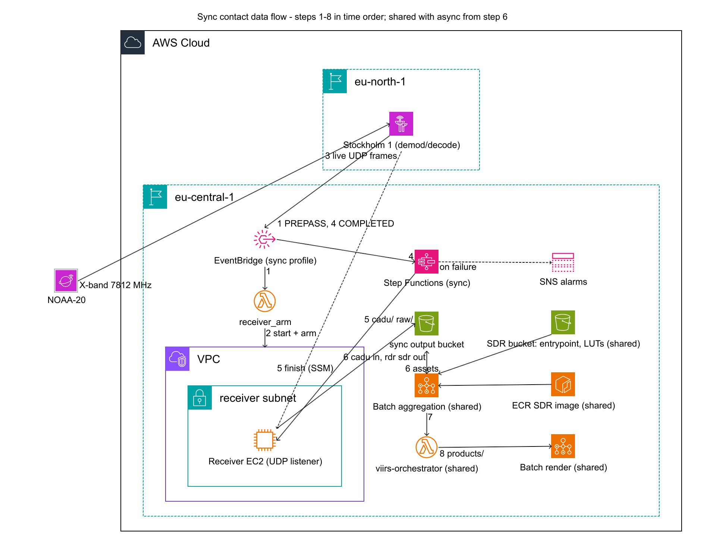
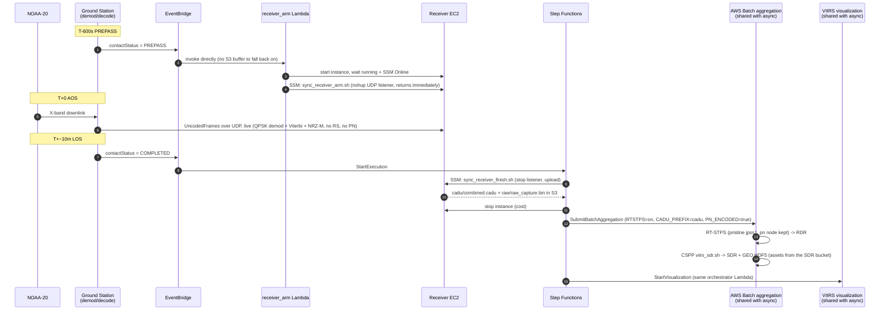

# Synchronous pipeline — live demod/decode reception

A second, independent reception path for NOAA-20, alongside the DigIF pipeline described
in [`ARCHITECTURE.md`](ARCHITECTURE.md). Not yet flown.

> **2026-11-19: the sync mission profile now gets contacts offered** (21-34 per onboarded station over
> 7 days). Until then it got 0 on every station because of two config defects: the
> `DataflowEndpointConfig` lacked `dataflowEndpointRegion`, and the demod/decode `unvalidatedJSON`
> strings were re-serialised by `jsonencode` (keys sorted). Both fixed in `groundstation.tf` (JSON now in
> `files/`). Investigation and trials: `.kiro/skills/aws-ground-station/references/sync-and-digital-twin.md`.

This documents the design as built, consolidated from the header comments across
[`infra/modules/sync_pipeline/`](../infra/modules/sync_pipeline/),
[`lambdas/receiver_arm/`](../lambdas/receiver_arm/) and `scripts/sync_receiver_*`.

## Why a second pipeline

The existing pipeline receives **DigIF** — raw digitized RF, undemodulated. That is why
one 10-minute contact is ~43 GB: DigIF ships roughly 30× the actual demodulated bitstream
(see `ARCHITECTURE.md`'s cost table). AWS Ground Station can instead demodulate and
FEC-decode on the antenna side and deliver the much smaller decoded-frame stream live,
during the contact — `AntennaDownlinkDemodDecodeConfig`. This pipeline exercises that
path: a dedicated mission profile, a receiver EC2 that the decoded stream is delivered
to over UDP in real time, and a much shorter post-contact chain (no S3 chunk fan-out,
because there's nothing to fan out). From the frames in S3 onwards it shares the async
pipeline's chain (see "Shared chain" below).

**Separate up to the frames, shared after them.** The reception side is its own: mission
profile, dataflow endpoint, receiver EC2, EventBridge rules (filtered on its profile), Step
Functions state machine, IAM roles, output bucket and alarms. From the frames in S3 onwards it
uses the async pipeline's components: the Batch aggregation job and SDR image, the CSPP assets in
the SDR bucket, and the visualization Lambda and render job (architecture principle "converge
early, mutualize the rest", [`ARCHITECTURE.md`](ARCHITECTURE.md#architecture-principle-converge-early-mutualize-the-rest)).

## Architecture

Data flow during a sync contact (source: [`diagrams/sync-contact-dataflow.yaml`](diagrams/sync-contact-dataflow.yaml)):



Step-by-step sequence:



> **Shared chain (2026-11-20).** Following the architecture principle "converge early,
> mutualize the rest" ([`ARCHITECTURE.md`](ARCHITECTURE.md#architecture-principle-converge-early-mutualize-the-rest)),
> the sync path joins the async one at the frames in S3: the receiver only captures and
> uploads, and the **same** aggregation Batch job, image, CSPP assets and visualization run
> both paths. The former split (RT-STPS on the receiver, `RTSTPS=off` CSPP-only job, CodeBuild
> fallback) is retired. Never run on real data yet (no sync contact flown).

## Component reference

| Layer | Resource | File |
|---|---|---|
| Ground Station config | `AntennaDownlinkDemodDecodeConfig` (QPSK, Viterbi 1/2, NRZ-M, `UncodedFramesEgress`), tracking config, dataflow endpoint config, mission profile `noaa20_sync` | [`groundstation.tf`](../infra/modules/sync_pipeline/groundstation.tf) |
| Receiver network | Dedicated EC2 + SG (UDP ingress from Ground Station's managed prefix list only, HTTPS egress for SSM/S3), dataflow endpoint group bound to its ENI | [`ec2.tf`](../infra/modules/sync_pipeline/ec2.tf) |
| Pre-AOS arm | `receiver_arm` Lambda: start EC2, poll running + SSM Online, `SendCommand` to arm the listener | [`lambda.tf`](../infra/modules/sync_pipeline/lambda.tf), [`lambdas/receiver_arm/handler.py`](../lambdas/receiver_arm/handler.py) |
| Live listener | UDP socket bound before AOS, strips a VITA-49-style header per packet, writes the decoded CCSDS frame stream to disk, plus a raw tee of every payload | [`scripts/sync_receiver_listen.py`](../scripts/sync_receiver_listen.py) |
| Post-LOS handoff | Stop listener, upload the raw tee then the frame capture to S3 (no RT-STPS on the receiver) | [`scripts/sync_receiver_finish.sh`](../scripts/sync_receiver_finish.sh) |
| Orchestration | Step Functions: wait, `FinishReceiver` (SSM), poll, stop EC2, `SubmitBatchAggregation`, `StartVisualization` | [`step_functions.tf`](../infra/modules/sync_pipeline/step_functions.tf) |
| Aggregation (**shared**) | The async pipeline's on-demand Batch aggregation job (`...-agg-queue`, `...-aggregation`, SDR image): `RTSTPS=on CADU_PREFIX=cadu PN_ENCODED=true`, `OUTPUT_BUCKET` = sync bucket, `ASSETS_BUCKET` = SDR bucket | [`infra/modules/batch_compute/`](../infra/modules/batch_compute/), [`scripts/aggregation_entrypoint.sh`](../scripts/aggregation_entrypoint.sh) |
| Triggers | PREPASS → Lambda direct invoke; COMPLETED → state machine. Both filtered on this module's `missionProfileArn` | [`eventbridge.tf`](../infra/modules/sync_pipeline/eventbridge.tf) |
| Alarms | EC2 status checks (with auto-recovery), Lambda errors, Step Functions failures, receiver readiness, `/opt/scripts` drift → shared SNS topic | [`monitoring.tf`](../infra/modules/sync_pipeline/monitoring.tf) |

## What is materially different from the async pipeline

Only what the data forces; everything from the frames in S3 onwards is shared.

- **No S3 buffer before the capture.** The async pipeline can recover from a late Lambda
  because chunks sit in S3 regardless. Here the receiver must be running and its listener
  bound *before* AOS or the pass is lost outright — hence the 600 s
  `contact_pre_pass_duration_seconds` budget (up to 240 s for EC2 running, 120 s for SSM agent
  registration, plus margin) and the dedicated alarms in `monitoring.tf`. Once the capture is
  in S3 it is replayable through the shared job like any async contact.
- **`PN_ENCODED=true`, not `false`.** The async pipeline's SatDump step already
  derandomizes PN before RT-STPS runs. `UncodedFramesEgress` does not — no Reed-Solomon, no
  PN — so the shared job runs RT-STPS with the pristine `config/jpss1.pn-encoded.xml`
  (`PnEncoded="true"`, `frame_sync -> pn -> reed_solomon`) instead of the patched config. Get
  this backwards and RT-STPS silently discards every frame (XORing already-clean data back into
  noise), the same failure mode documented in `ARCHITECTURE.md`'s PN note.
- **One combined capture**, not 22 chunks: there is no fan-out stage on this path.
- **Packet format is not fully verified.** See the open risk below.

## Former blocker -- zero sync windows (resolved 2026-11-19)

From 2026-10-22 to 2026-11-18 Ground Station offered **zero schedulable windows** for the sync
profile while the DigIF profile got many. `docs/SYNC_ONBOARDING_INVESTIGATION.md` attributed this
to onboarding. **That conclusion was wrong**: AWS support confirmed demod/decode onboarding, and
single-factor trials against AWS's `AquaSnppJpss.yml` isolated two config defects (missing
`dataflowEndpointRegion`; `jsonencode`d `unvalidatedJSON`). After the fix the profile gets 21-34
contacts per onboarded station over 7 days. No sync contact has been flown yet, so the packet-format
risk below is now the live one.

## Open risk — packet format unverified

`scripts/sync_receiver_listen.py` assumes the demod/decode `UncodedFramesEgress` stream
uses AWS's "VITA-49 Extension" format with the *same* 4-byte big-endian header layout as
the DigIF "VITA-49 Signal Data/IP Format" reference in `scripts/vita49_extract.py`
(7-word/28-byte header, type in top 4 bits, size in low 16 bits). AWS documents that these
two formats are explicitly different and that the exact layout is provided during
satellite onboarding, not published. **This has not been validated against real traffic.**

If RT-STPS's `frame_sync` fails to lock on the first real capture, the fix is not to
re-guess the header — capture a short sample with `sync_receiver_listen.py --raw-passthrough`
and inspect it by hand against the onboarding-provided spec. The C/T/TSI/TSF flag bits
can change the header length by up to 5 words, which the fixed 7-word assumption does not
account for.

## Packet-format validation gate (REL-5)

**The sync path is not flight-ready until the packet format has been validated against a
real traffic capture.** The current parser assumes a 7-word/28-byte VITA-49 header — the
same fixed layout used by the DigIF reference scripts. AWS documents the demod/decode
VITA-49 Extension format as explicitly different, with the exact per-satellite layout
provided at onboarding. Until the assumption is confirmed, every pass is a format
validation experiment.

### Clearing the gate

1. **Capture a raw sample.** `sync_receiver_arm.sh` now passes `--raw-tee
   ${WORK_DIR}/raw_capture.bin` to the listener by default (Task 9.2). This writes every
   raw UDP payload to `raw_capture.bin` alongside the normal parsed frame stream.
   After the pass, `sync_receiver_finish.sh` uploads it to
   `s3://<bucket>/contacts/<date>/<contact>/raw/raw_capture.bin`.

   Alternatively, run the listener manually with `--raw-passthrough` to capture raw
   payloads only (no VITA-49 header parsing) to the main output file.

2. **Inspect against the onboarding spec.** Open the captured file in a hex editor and
   compare the byte layout to the VITA-49 Extension packet format provided by AWS during
   satellite onboarding. Confirm: header word count, packet-type field position, size
   field position, payload start offset. Check whether the C/T/TSI/TSF flag bits are set
   — these can extend the header by up to 5 words beyond the 7-word assumption.

3. **Confirm RT-STPS frame_sync locks.** Run RT-STPS against a real pass and confirm
   `frame_sync` logs successful lock and produces RDR HDF5 output. Zero RDR output with
   frame-sync errors means the header parsing is stripping too many or too few bytes.
   Zero RDR output with no frame-sync errors means the frames are malformed before
   reaching RT-STPS. Since the shared chain, the aggregation job itself FAILS in the sync
   configuration (`PN_ENCODED=true`) when there is no `RNSCA-RVIRS*.h5` RDR or CSPP yields zero
   SDR/GEO (RDR files are uploaded first as evidence), so the state machine reaches Catch and SNS
   instead of a silent success. A visualization failure notifies via SNS and a metric alarm
   (`SyncPipeline` namespace) before the execution ends.

4. **Record the result.** Once all three steps pass, update this section with the contact
   ID, date, and verified header layout. Until then, treat the `ReceiverReadyFailure`
   metric and the raw tee as diagnostic infrastructure, not a production-ready pipeline.

**Related:** `scripts/sync_receiver_listen.py`'s module docstring has the full header
caveat. The Terraform `ReceiverReadyFailure > 0` alarm (Task 9.1, `monitoring.tf`) fires
during PREPASS if the listener fails to bind before AOS.

---

## Manual prerequisites (installed by hand, outside Terraform)

Same pattern as the existing aggregation EC2 (`ARCHITECTURE.md`'s constraints section):
`ec2.tf` deliberately ships no `user_data`. Before the first test, the receiver instance
needs, copied to the paths the scripts expect:

| Path | Contents |
|---|---|
| `/opt/scripts/sync_receiver_arm.sh`, `sync_receiver_finish.sh` (executable) | this repo's `scripts/` |
| `/opt/scripts/sync_receiver_listen.py` | this repo's `scripts/` |

That is all: no `/opt/rt-stps` on the receiver since 2026-11-20 (RT-STPS runs in the shared
aggregation job, from the SDR image). The `OptDriftDetected` alarm checks these three files.

Two receiver constraints found by the 2026-11-20 dry run:

- **Egress path.** The receiver has two ENIs (primary + the dataflow ENI), so AWS gives it no
  automatic public IP, and the default VPC has no NAT or VPC endpoint. Without the Elastic IP
  on the primary ENI (`aws_eip.receiver`, about 3.6 USD/month), SSM Run Command (arm/finish)
  and the S3 upload cannot work. Check `aws ssm describe-instance-information` shows it Online
  a minute after start.
- **Python 3.9.** The AMI ships Python 3.9: `sync_receiver_listen.py` must stay
  3.9-compatible (`from __future__ import annotations`, no `match`). A regression test in
  `tests/test_sync_receiver_listen.py` guards it.

## Enabling it

```hcl
# infra/terraform.tfvars
enable_sdr_pipeline  = true   # required — sync_pipeline reuses its ECR image
enable_sync_pipeline = true
```

`terraform apply` then creates a second, independent mission profile
(`noaa20_sync`) alongside the existing async one. Both can be enabled simultaneously
against the same satellite.

## Choosing which pipeline runs for a given contact

**The mission profile ARN you reserve the contact against decides which pipeline runs.** Both
pipelines' EventBridge rules filter on `detail.missionProfileArn` (`eventbridge.tf` in
`sync_pipeline` and `sdr_pipeline`), so a contact reserved on one profile never triggers the other
state machine. The async rule only matches the Terraform-managed profile (`mission_profile_arn`
output); a contact booked on the legacy unmanaged `2655b0f6-...` profile triggers nothing.
(Until 2026-11-19 the async rule matched any COMPLETED contact, so a sync contact would also have
started the async state machine.)

```bash
# Async (DigIF) — existing pipeline
terraform -chdir=infra output mission_profile_arn

# Sync (demod/decode) — this pipeline
terraform -chdir=infra output sync_pipeline_mission_profile_arn
```

To fly the sync pipeline, pass the **sync** ARN to both `list-contacts` (so the offered
windows reflect this mission profile's tracking config) and `reserve-contact`:

```bash
MP_SYNC=$(terraform -chdir=infra output -raw sync_pipeline_mission_profile_arn)
# satellite_id is the UUID in terraform.tfvars; build the ARN the same way
# existing manual reserve-contact calls do (see docs/CONTACTS.md)
SAT="arn:aws:groundstation:eu-central-1:471112743408:satellite/33f035e1-73f7-47a5-9df8-fbc48636dca8"

aws groundstation list-contacts --status-list AVAILABLE \
  --ground-station "Stockholm 1" --mission-profile-arn "$MP_SYNC" --satellite-arn "$SAT" \
  --start-time <now> --end-time <now+7d> > contacts_sync.json

aws groundstation reserve-contact \
  --mission-profile-arn "$MP_SYNC" --satellite-arn "$SAT" \
  --ground-station "Stockholm 1" \
  --start-time <aos> --end-time <los>
```

Reserving against the async mission profile ARN (the existing `mission_profile_arn`
output) runs the DigIF pipeline exactly as before. The choice is per contact, not a global
switch.

## First sync contact - checklist

A first sync contact is a **packet-format experiment**, not a production pass: expect RT-STPS
frame sync to fail on the first try. The goal is a raw capture you can inspect. Do the steps in
order; each one is cheap except step 6 (paid, ~$105 at Stockholm 1, explicit user go-ahead).

> **Status 2026-11-26: the sync path is BLOCKED by a design fault.** Ground Station dataflow
> endpoint streams are DTLS; the receiver must run the AWS dataflow endpoint application (DDX),
> which it does not. Contacts #8 and #9 both failed. Read
> [`LESSONS_SYNC_FIRST_CONTACTS.md`](LESSONS_SYNC_FIRST_CONTACTS.md) before booking anything.
>
> **Before step 6 (reserve), complete the dry run in [`SYNC_DRY_RUN.md`](SYNC_DRY_RUN.md).**
> The dry run invokes the real Lambda and state machine (not operator credentials) and must
> pass before the contact is booked. See that document for the full deviation list and
> PowerShell commands.

1. **Check the async rule is scoped**: `contact-completed-sdr`'s event pattern must contain
   `missionProfileArn` (done 2026-11-19; `aws events describe-rule --name
   groundstation-noaa20-contact-completed-sdr`). Otherwise a sync contact also starts the async
   state machine.
2. **Install the receiver prerequisites.** Start `groundstation-noaa20-sync-receiver`
   (`i-06a51f5b29e26aeaa`, stopped between contacts), then via SSM install the files listed in
   "Manual prerequisites" above: the three `/opt/scripts/sync_receiver_*` scripts from this
   repo (staged in `s3://<sync bucket>/software/`). No RT-STPS on the receiver. Check
   `python3 --version` and that `/opt/scripts/*.sh` are executable.
   Also check the **shared chain is ready**: the SDR image in ECR contains
   `/opt/rt-stps/config/jpss1.pn-encoded.xml` (rebuilt after 2026-11-20), and the deployed
   `software/aggregation_entrypoint.sh` in the SDR bucket accepts `PN_ENCODED`.
3. **Dry arm, no contact.** Run the same command the `receiver_arm` Lambda sends
   (`lambdas/receiver_arm/handler.py`), with a fake contact id:
   `/opt/scripts/sync_receiver_arm.sh <bucket> dryrun-0000 <yyyy/mm/dd> 55888`
   (SSM `AWS-RunShellScript`). Confirm the listener is bound (`ss -ulpn | grep 55888`) and the
   work dir exists under `/var/tmp/sync_receiver/dryrun-0000/`. Then run
   `/opt/scripts/sync_receiver_finish.sh <bucket> dryrun-0000 <yyyy/mm/dd>` and check it stops the
   listener and fails cleanly on an empty capture. Stop the instance.
4. **Check the alarm path.** The sync alarms (`ReceiverReadyFailure`, receiver-arm Lambda errors,
   Step Functions failures) should be `OK` and their SNS topic should have a confirmed subscription.
5. **Choose the window.** `scripts/gs_list_sync_contacts.ps1` (read-only). Prefer Stockholm 1:
   same region as the receiver, and the most offers. Avoid passes in the next 30 minutes: the
   PREPASS arm needs the 600 s pre-pass budget.
6. **Reserve** with the **sync** profile ARN (`reserve-contact` above). Record it in
   `docs/CONTACTS.md` immediately (contact id, window, profile, "sync, format experiment").
7. **During PREPASS** (T-600 s): watch `/aws/lambda/...receiver-arm` logs - EC2 running, SSM
   Online, arm command sent. If `ReceiverReadyFailure` fires, the pass is lost (no S3 buffer).
8. **After LOS**: the sync state machine runs `sync_receiver_finish.sh` (uploads `raw/` then
   `cadu/`), stops the instance, then the shared aggregation job (`PN_ENCODED=true`). Whatever
   the outcome, fetch `s3://<bucket>/contacts/<date>/<contact>/raw/raw_capture.bin`. If RT-STPS
   finds no frames, the capture stays in S3: fix the parser or the PN setting and **replay**
   the aggregation job on it, without a new contact.
9. **Inspect the capture** against the onboarding-provided VITA-49 Extension layout
   ("Clearing the gate" above): header word count, packet type and size fields, payload offset.
10. **Record the result** in this file (verified header layout or what differed) and in
    `docs/CONTACTS.md`. Verify products by evidence, not execution status: `scripts/verify_pass.py`
    does not know the sync state machine yet, so check the S3 prefixes by hand.
