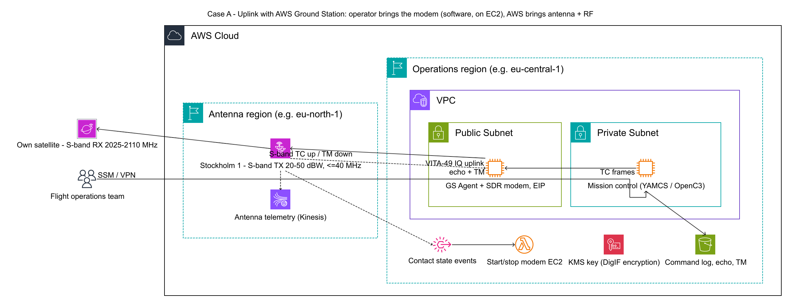
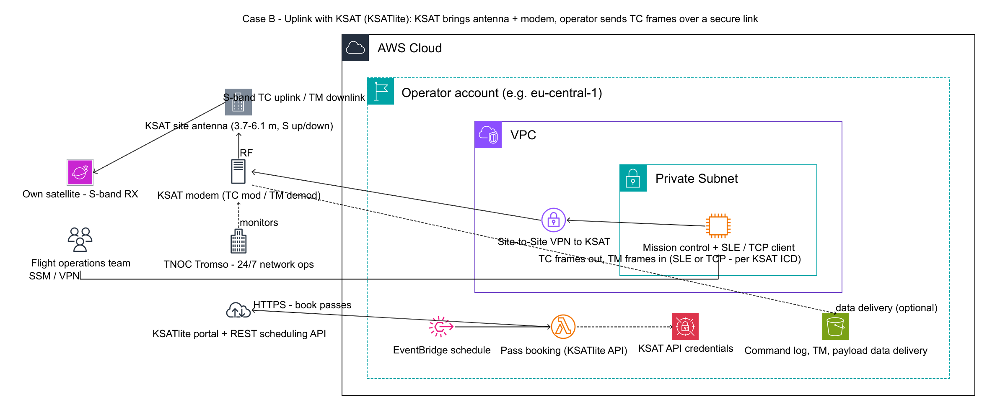

# Uplink to a satellite: AWS Ground Station vs KSAT

Compiled 2026-11-19. Amazon Web Services (AWS) facts come from the AWS user guide (linked). Kongsberg Satellite Services (KSAT) publishes far less, so
several KSAT points are marked `[unverified]` and must be confirmed in the KSAT interface control document (ICD) and quote.
Diagrams: `docs/diagrams/uplink-aws-groundstation.yaml` and `docs/diagrams/uplink-ksat.yaml`
(awsdac v0.23), rendered to `docs/diagrams/out/`.

---

## 0. Prerequisite common to both: you need your own satellite

Neither provider lets you transmit to a satellite you do not operate. The public broadcast
satellites this project receives (NOAA-20, NOAA-21, Suomi National Polar-orbiting Partnership (SNPP), Terra) are downlink-only: AWS states
that you cannot uplink to them
([onboard satellite](https://docs.aws.amazon.com/ground-station/latest/ug/getting-started.step1.html#public-broadcast-satellites)).
Amateur satellites are a separate route, covered in `docs/SATELLITES_PBS_AND_UPLINK.md`.

What the operator must bring in both cases:

| Item | Requirement |
|---|---|
| Spacecraft receiver | S-band telecommand (TC) receiver/transponder. AWS sites transmit only in **2025-2110 MHz** (see section A1); KSAT S-band uplink is in the same space-operations band `[unverified: exact KSAT range per site]` |
| Command protocol | Consultative Committee for Space Data Systems (CCSDS) TC (TC frames, communications link transmission unit (CLTU)) is the de facto standard; on-board authentication/encryption (CCSDS Space Data Link Security (SDLS)) strongly recommended, since the ground link is shared infrastructure. Details: [Appendix A](#appendix-a---ccsds-telecommand-and-sdls) |
| Frequency rights | International Telecommunication Union (ITU) filing for the space station through the national administration (in France, the national frequency agency (ANFR)), plus the national space operations authorization (French Space Operations Act). Each ground station country then licenses the earth station to transmit: AWS and KSAT both file these site licences, using the operator's data |
| Ephemeris | North American Aerospace Defense Command (NORAD) identifier (ID) and a Space-Track two-line element set (TLE) at minimum; precise Orbit Ephemeris Message (OEM) ephemeris recommended, especially in launch and early orbit phase (LEOP) |
| Mission control software (MCS) | Builds and logs commands, decodes telemetry. Open-source: Yet Another Mission Control System (YAMCS), OpenC3 COSMOS, National Aeronautics and Space Administration (NASA) F' ground system. Commercial: Kratos EPOCH and others |

---

## Case A - AWS Ground Station

### A1. What AWS provides and what it does not

AWS rents the antenna and the radio frequency (RF) chain. **It does not modulate your commands.** The
`AntennaUplinkConfig` only carries a spectrum config (centre frequency, polarization), a target
effective isotropic radiated power (EIRP) and an optional `transmitDisabled` flag
([application programming interface (API)](https://docs.aws.amazon.com/ground-station/latest/APIReference/API_AntennaUplinkConfig.html)).
The data you send to it must already be digitized RF: **VMEbus International Trade Association radio transport standard 49 (VITA-49) Signal Data/Internet Protocol (IP)** (in-phase and quadrature (IQ) samples)
([data plane interfaces](https://docs.aws.amazon.com/ground-station/latest/ug/dataflows.html#dataflows.interfaces)).
So the modulator (and the telemetry (TM) demodulator, unless you use demod/decode) runs as software on your Elastic Compute Cloud (EC2).

Uplink capability, identical at all sites
([site capabilities](https://docs.aws.amazon.com/ground-station/latest/ug/locations.capabilities.html)):

| | Value |
|---|---|
| Frequency | The API accepts a centre frequency of 2025-2120 MHz ([UplinkSpectrumConfig](https://docs.aws.amazon.com/ground-station/latest/APIReference/API_UplinkSpectrumConfig.html)), as do the frequently asked questions (FAQ) and NASA's 2026 State of the Art (SOA) report; the site capability table says 2025-2110. Design for 2025-2110, the ITU space-operation Earth-to-space band that every site is licensed for |
| Bandwidth | up to 40 MHz |
| Polarization | Right-hand circular polarization (RHCP) or left-hand circular polarization (LHCP), one at a time |
| EIRP | 20-50 dBW |
| Uplink echo | 2 MHz, same frequency range: a copy of what the antenna actually radiated, returned to your endpoint to verify commands |

Uplink is synchronous only: Simple Storage Service (S3) delivery is downlink-only
([dataflow paths](https://docs.aws.amazon.com/ground-station/latest/ug/getting-started.step2.html)).

### A2. Hardware requirements

No ground hardware. On AWS:

- **Modem / agent EC2** in a public subnet with an Elastic IP. The recommended path is the
  **AWS Ground Station Agent** with a `DataflowEndpointGroupV2`, which now supports uplink
  (`UplinkAwsGroundStationAgentEndpoint`) as well as downlink, on the same instance
  ([dataflow endpoint group (DFEG) versions](https://docs.aws.amazon.com/ground-station/latest/ug/how-it-works.dataflow-endpoint-group.html)).
  The agent needs dedicated cores and one of the listed instance types; the smallest is
  m5.8xlarge (32 vCPU, 100 MHz aggregate), common choices c5.12xlarge / c7i.12xlarge
  ([instance types](https://docs.aws.amazon.com/ground-station/latest/gs-agent-ug/agent-instance-selection.html)).
  Operating system (OS): Amazon Linux 2023 (recommended) or Amazon Linux 2 (AL2).
  The legacy alternative is a `DataflowEndpoint` with the AWS "dataflow endpoint application" Amazon Machine Image (AMI)
  (private AMI shared after onboarding), which also supports uplink.
- **MCS EC2** (small, private subnet, always on).
- Optional: a lab RF test set or engineering model of the transponder. AWS has no test RF
  station; the digital twin (A5) does not carry data.

### A3. Software requirements

| Layer | Options | Notes |
|---|---|---|
| Ground Station Agent | AWS, free; public AMI or Red Hat Package Manager (RPM) | Encrypts digital intermediate frequency (DigIF) with your Key Management Service (KMS) key, forward error correction (FEC) on the AWS backbone |
| Modem (TC modulator, TM demodulator) producing/consuming VITA-49 IQ | Commercial software modems (e.g. Kratos quantumRadio; Amergint softFEP), or your own GNU Radio flowgraph | Must match the spacecraft waveform (e.g. binary phase-shift keying (BPSK), pulse-code modulation on a phase-shift-keyed subcarrier, phase-modulated onto the carrier (PCM/PSK/PM) with subcarrier, Gaussian minimum-shift keying (GMSK)) and CLTU/Bose-Chaudhuri-Hocquenghem code (BCH) coding. Licence by quote; a home-built modem is engineering effort, not licence cost |
| MCS | YAMCS, OpenC3 COSMOS, EPOCH... | Sends TC frames to the modem, logs every command |
| Automation | EventBridge contact-state events, Lambda to start/stop the modem EC2 before acquisition of signal (AOS) | Same pattern as this repo's receiver arm Lambda |

If you do not want to own the modem, AWS ground station as a service (GSaaS) partners resell AWS antennas with a managed
modem in front: Skynopy (Paris) runs virtualized modems over AWS Ground Station, and EnduroSat
lists "AWS GS (Skynopy)", that is AWS Ground Station (GS) through Skynopy, as a compatible network for its S-band radio
([Skynopy profile](https://newspacemarket.com/wp-content/uploads/kls-company-pdf/skynopy.pdf),
[EnduroSat](https://www.endurosat.com/products/s-band-transceiver-max/)). KSAT can also sell AWS
antennas (see the side-by-side section). Prices: quote.

### A4. AWS resources

- Virtual private cloud (VPC), public subnet + Elastic IP address (EIP) for the agent, security group allowing User Datagram Protocol (UDP) from the
  `com.amazonaws.global.groundstation` prefix list on the DFEG ports and Transport Layer Security (TLS) 443 out
  ([agent requirements](https://docs.aws.amazon.com/ground-station/latest/gs-agent-ug/agent-requirements.html)).
- KMS key (agent data encryption), Identity and Access Management (IAM) role for Ground Station.
- Configs: `TrackingConfig`, `AntennaUplinkConfig`, `UplinkEchoConfig`, downlink config
  (`AntennaDownlinkConfig` or `AntennaDownlinkDemodDecodeConfig`), `DataflowEndpointConfig`
  (set `dataflowEndpointRegion`; see the steering note on 0-contact profiles), optional
  `TelemetrySinkConfig` to Kinesis.
- Mission profile with edges: `DataflowEndpoint(uplink) -> AntennaUplink`,
  `UplinkEcho -> DataflowEndpoint`, `AntennaDownlink -> DataflowEndpoint`.
- DFEG must be `HEALTHY` before a contact can be scheduled.

### A5. Architecture



Command path: operator -> MCS -> TC frames -> software modem -> VITA-49 IQ (UDP, encrypted by
the agent) -> antenna -> S-band. The uplink echo and the TM downlink come back to the same agent.

### A6. Onboarding

1. Prerequisite: your ITU filing (and Federal Communications Commission (FCC) filing if relevant) and your satellite operating licence
   must already exist; AWS only licenses its earth stations.
2. Satellite Onboarding Questionnaire in the console, non-disclosure agreement (NDA), technical validation. AWS returns a
   licensing cost estimate per location; after you approve, it files with each regulator.
   AWS's own non-binding estimates ([FAQ](https://aws.amazon.com/ground-station/faqs/)):

   | Country | Licensing time |
   |---|---|
   | Ireland | 45 days |
   | Sweden | 3+ months |
   | United States | 3+ months |
   | Chile, South Africa | 3-6 months |
   | Bahrain, Singapore | 6+ months |
   | Australia | 9+ months |

   AWS gives no updates between filing and the regulator's decision. For a European mission,
   Ireland 1 and Stockholm 1 are the fastest to license.
3. Digital twin (optional): exact copies of the ground stations for scheduling, config and
   EventBridge testing, without licence or antenna use. It does **not** support data delivery, so
   it cannot test the modem or the RF link
   ([digital twin](https://docs.aws.amazon.com/ground-station/latest/ug/digital-twin.html)).
4. First live contacts with `transmitDisabled: true` and uplink echo, then real transmission.

### A7. Cost

Billing is per contact-minute, rounded up, by bandwidth tier (narrowband <= 40 MHz, wideband
> 40 MHz) and by site
([contact billing](https://docs.aws.amazon.com/ground-station/latest/ug/contacts.billing.html)).
Uplink is capped at 40 MHz, so an uplink contact is narrowband. The pricing web page no longer
shows figures, but the **AWS Price List API** does (`aws pricing get-products --service-code
AWSGroundStation --region us-east-1`, effective 2026-09-01):

| Ground station | Narrowband on-demand | Wideband on-demand |
|---|---|---|
| Bahrain 1, Cape Town 1, Ireland 1, Ohio 1, Oregon 1, Singapore 1, Stockholm 1 | **$10/min** | $22/min |
| Alaska 1, Dubbo 1, Hawaii 1, Punta Arenas 1 | **$15/min** | $25/min |
| Digital twin (any site) | $0.50/contact (first 1,000), $0.30 (1,000-5,000), $0.15 beyond | same |

This account's Cost Explorer (Jan-Nov 2026) matches exactly: Stockholm 1, Ohio 1 and Oregon 1
billed $10/min, Hawaii 1 $15/min (10 min = $150).

The Price List carries on-demand terms only. **Reserved rates are no longer published.** The last
public figures (March 2022 pricing page) were $3/min narrowband and $10/min wideband reserved,
with a minimum of 150 min/month for 12 months; reserved contacts cancelled more than 24 h ahead
were free. Treat $3/min as a historical reference until the account team quotes.

Other billing rules from the FAQ and pricing history:

- On-demand contacts can be booked 15 min to 7 days ahead. Cancelling an on-demand contact costs
  **100% of its price**.
- One contact is one metered line (usage type `<site>-Contact-<band>-Minute`), whatever the number
  of dataflows. An uplink + S-band TM contact is therefore one narrowband charge, not two.
  `[unverified]` Whether the 40 MHz threshold applies to each dataflow or to their sum. It only
  matters if the downlink in the same contact is wide (for example 50+ MHz X-band through the
  agent), which would bill the whole contact at the wideband rate.
- Site licensing is not free: AWS sends a cost estimate per location before it files
  ([FAQ](https://aws.amazon.com/ground-station/faqs/)). Amounts are not published.

Example: 2 contacts/day x 10 min = 600 min/month at a $10/min site.

| Item | On-demand | Reserved |
|---|---|---|
| Antenna time (600 min) | $6,000 ($9,000 at a $15/min site) | ~$1,800 if $3/min still applies `[quote]` |
| Modem/agent EC2, m5.8xlarge ~$1.84/h (eu-central-1, approx.), armed 30 min per contact = 30 h | ~$55 | ~$55 |
| Same EC2 left running 24/7 (what the arm/disarm Lambda avoids) | ~$1,340 | ~$1,340 |
| MCS EC2 (m6i.large, 24/7) | ~$85 | ~$85 |
| EIP, KMS key, Elastic Block Store (EBS), CloudWatch, S3 | ~$20 | ~$20 |
| **Monthly total** | **~$6,200** | **~$2,000** |
| Modem software licence | quote, or $0 for GNU Radio + engineering | same |
| One-off: onboarding, site licensing | no published fee `[unverified]` | same |

EC2 prices are approximate on-demand Linux rates; check the AWS Pricing Calculator.

**Data transfer of the uplink IQ stream (EC2 -> antenna).** No AWS document states how it is
billed; the only statement is that cross-region delivery adds no charge (AWS GSaaS blog), and that
is about downlink. It is small either way. Estimate, assuming 16-bit complex samples at 2.5 Msps
for a ~2 MHz uplink channel: 10 MB/s, so ~6 GB per 10-min contact, ~360 GB/month. Even billed at
the internet-egress rate ($0.09/GB) that is ~$32/month; at the regional EIP rate ($0.01-0.02/GB),
$4-7. This project has never run an agent contact, so there is no billing line to check against.
`[unverified]` sample format and rate (set by your modem and the VITA-49 profile given at
onboarding).

---

## Case B - KSAT (KSATlite)

### B1. What KSAT provides

KSATlite is KSAT's automated ground-segment-as-a-service for small satellites: 26 stations and
150+ antennas of 3.7-6.1 m (product page; a 2026 KSAT article says nearly 35 stations and 200
antennas, the figure another KSAT article gives as the 2028 target), S-band up and down, X-band and Ka-band down, representational state transfer (REST) machine-to-machine
scheduling, a customer portal, anomaly detection and 24/7 operations at the Tromso Network
Operations Centre ([KSATlite](https://www.ksat.no/ground-network-services/ksatlite/),
[operations](https://www.ksat.no/ground-network-services/ksatlite/operations-and-scheduling/)).
The full KSAT network is larger (300+ antennas, ~28 sites) and includes Svalbard and Troll, which
see a polar low Earth orbit (LEO) satellite on every orbit.

The key difference with AWS: **KSAT owns the modem.** You send command frames (or ready-made
CLTUs, depending on the ICD), KSAT modulates and radiates them. Your waveform must be one KSAT's
baseband supports. Stage-by-stage comparison: [TC data pipeline](#tc-data-pipeline---from-command-to-spacecraft).

What could be found publicly (Nov 2026) about the uplink, and what could not:

| Item | Finding | Source |
|---|---|---|
| KSATlite antenna | Baseline 3.7 m, S-band up, S/X down; Ka-band down on part of the network | [NASA SOA 2026, ch. 11](https://www.nasa.gov/wp-content/uploads/2026/05/11-soa-ground-data-systems-2026-final.pdf) |
| Uplink frequency | KSATlite: S-band uplink 2025-2120 MHz, downlink 2200-2290 MHz, behind a "standardized 4-channel baseband unit" (stated for the KSATlite Ka-band sites). Tromso: 2025-2110 MHz in an FCC exhibit | [KSATlite Ka-band](https://www.ksat.no/ground-network-services/ksatlite/ksatlite-ka-band-services/), [FCC exhibit](https://apps.fcc.gov/els/GetAtt.html?id=311264&x=.) |
| Uplink EIRP | **KSATlite 3.7 m dishes: not public.** Only small-antenna data point: 33.1 dBW, RHCP, from a Yagi at Tromso. KSAT's large-aperture stations, as published by NASA: Svalbard SG1 11.3 m 63.5 dBW, SG2 11.3 m 59 dBW, SG3 13 m 67 dBW; Troll TR2/TR3 7.3 m 51 dBW; Singapore SI1 9.1 m 59 dBW. Leaf Space's 3.7-3.9 m dishes are filed at 50 dBW, which brackets what a 3.7 m KSATlite dish can do | FCC exhibit; [NASA Near Earth Network (NEN) Users' Guide rev. 4](https://explorers.larc.nasa.gov/HPSMEX22/pdf_files/12_453-UG-002905.pdf); NASA SOA |
| Modulation | KSATlite list not published. KSAT's NASA-supporting large stations command in frequency-shift keying (FSK), BPSK, binary phase-shift keying plus amplitude modulation (BPSK+AM), PCM/PSK/PM (subcarrier 5 kHz-2 MHz, 100 bps-250 kbps) and direct PCM/PM, 10 bps-1 Mbps on the carrier (NEN guide). KSAT describes the KSATlite radios as software-defined and supporting "all the major standards"; EnduroSat's BPSK/quadrature phase-shift keying (QPSK) radio (0.5-4 Msps) is sold as KSATlite-compatible | NEN guide; [KSAT 2022](https://www.ksat.no/news/news-archive/2022/high-success-rate-for-ksatlite-the-last-12-months/); [EnduroSat](https://www.endurosat.com/products/s-band-transceiver-max/) |
| TC/TM ground interface (Space Link Extension (SLE) vs Transmission Control Protocol (TCP)) | **Not published for KSATlite.** KSAT states a "standardised machine-to-machine (M2M) interface", REST scheduling, and monitoring-and-control APIs that let operators observe and reconfigure a live contact. KSAT's NASA-supporting stations offer IP, serial clock and data, and 4800-bit blocks in IP (NEN guide); SLE support is not stated there either | [KSATlite onboarding](https://www.ksat.no/ground-network-services/ksatlite/onboarding/), [KSAT 2026](https://www.ksat.no/news/news-archive/2026/ksatlite-10-years-8-minutes-to-make-it-count/), NEN guide |
| AWS integration | Since 2025 KSAT has integrated AWS Ground Station capabilities into the KSATlite architecture, with segmented file delivery from any station to any data centre | [KSAT 2026](https://www.ksat.no/news/news-archive/2026/ksatlite-10-years-building-a-global-network-that-feels-simple/) |
| Lead time | Not published. KSAT obtains the earth station authorization for its sites (confirmed in the same FCC exhibit) | FCC exhibit |
| Price | Not published. Per-pass or per-minute, no commitment (third party) | Woodrow Scientific |

These are all ICD and contract items: they need the request for information (RFI) in the last section.

KSAT also offers satellite operations as a service (including LEOP), spectrum and licensing
support, a test lab, and a portable "suitcase" ground station shipped to you for compatibility
testing before launch ([onboarding](https://www.ksat.no/ground-network-services/ksatlite/onboarding/)).

### B2. Hardware requirements

None at the ground station. Operator side: an MCS host (on AWS or on premises) and a secure
network path to KSAT. Before launch, the spacecraft (or its flatsat/engineering model) goes
through RF compatibility testing with the KSAT test lab or the portable station.

### B3. Software requirements

| Layer | Options | Notes |
|---|---|---|
| MCS | YAMCS, OpenC3, EPOCH... | Same as case A |
| TC/TM ground interface | CCSDS SLE (SLE Forward CLTU service (FCLTU) for commands, Return All Frames (RAF)/Return Channel Frames (RCF) for telemetry) or a TCP frame interface | `[unverified]` which of these KSATlite offers for your mission: confirm in the ICD. YAMCS supports SLE |
| Scheduling | Client for the KSATlite REST API (e.g. a Lambda) | Immediate booking confirmation per KSAT |
| Network | Site-to-site Internet Protocol Security (IPsec) virtual private network (VPN), software-defined wide area network (SD-WAN) or private line; cloud delivery to AWS/Azure | KSAT mentions cloud integration and SD-WAN; options are per contract |

### B4. Architecture



Command path: operator -> MCS -> TC frames over the VPN -> KSAT modem -> antenna -> S-band. TM
frames return the same way; payload data can be delivered to your cloud storage.

### B5. Onboarding

Contract and ICD, frequency data for site licensing (KSAT supports the applications), network
integration, RF compatibility test, then pass booking. KSAT publishes no durations
`[unverified]`; site licensing is usually the longest item for both providers.

### B6. Cost

KSAT has no public rate card. A third-party comparison reports per-pass or per-minute pricing
and no upfront commitment for KSATlite
([Woodrow Scientific, Oct 2026](https://woodrowscientific.com/blog/cloud-based-satellite-ground-station-service-model/));
GSaaS S/X-band rates generally start around $3/min
([Payload](https://payloadspace.com/impact-of-in-space-relay-networks-on-ground-station-as-a-service/)).

Same 600 min/month example, **illustrative only (not a KSAT quote)**:

| Item | Monthly |
|---|---|
| Antenna time at an assumed $3-10/min | ~$1,800-6,000 |
| MCS EC2 (m6i.large, 24/7) | ~$85 |
| AWS Site-to-Site VPN, 1 connection ($0.05/h) | ~$36 |
| Data transfer out to KSAT (TC is a few MB) | < $1 |
| Secrets Manager, Lambda, S3 | ~$5 |
| **Monthly total** | **~$1,900-6,100** |
| One-off: integration, site licensing, compatibility test, network setup | quote |
| Optional: KSAT operations service, LEOP support | quote |

---

## TC data pipeline - from command to spacecraft

Both cases share the same top and bottom of the pipeline: the operator builds and secures the
command, the spacecraft decodes and executes it. What differs is the middle: **where the CLTU
becomes a radio signal, and who handles it on the way.** Protocol details are in
[Appendix A](#appendix-a---ccsds-telecommand-and-sdls).

### Flow

```
 OPERATOR (identical in both cases)
   Operator --> MCS: command + checks (mission database / XTCE, constraints, 2-person rule)
            --> Space Packet           (APID, 6-octet header)
            --> SDLS ApplySecurity     (SPI, IV, MAC - keys stay with the operator)
            --> TC Transfer Frame      (SCID, VCID, frame sequence number) + COP-1 FOP-1
            --> CLTU                   (start EB90, BCH or LDPC codeblocks, tail)
                     |                                         |
     Case A - AWS Ground Station                   Case B - KSAT (KSATlite)
     ---------------------------                  ------------------------
     CLTU over UDP/TCP inside your VPC            CLTU (or frame) over SLE F-CLTU or
                     |                            KSAT's interface, via site-to-site VPN
     YOUR software modem on EC2:                                   |
       PLOP (carrier, acquisition seq, idle)      KSAT baseband at the site:
       modulation --> IQ samples                    PLOP, modulation
       VITA-49 Signal Data/IP                       (KSAT-supported modes only)
                     |                                             |
     GS Agent: FEC + KMS encryption               KSAT upconverter, HPA, 3.7 m dish
     AWS backbone (cross-region allowed)                           |
                     |                                             |
     AWS antenna site: DAC, upconvert,                             |
     HPA, 5.4 m dish (20-50 dBW EIRP)                              |
                     |                                             |
                     +-------> S-band uplink 2025-2110 MHz <-------+
                                          |
 SPACECRAFT (identical)                   v
   receiver demod --> CLTU decode --> FARM-1 --> SDLS ProcessSecurity --> packet routing --> execute
                                          |
   CLCW in the TM Operational Control Field --> downlink --> MCS FOP-1 (ack or retransmit)
```

Acronyms used only in the diagram: Extensible Markup Language (XML) Telemetric and Command Exchange (XTCE), the mission
database format; digital-to-analog converter (DAC); high-power amplifier (HPA). `EB90` is the
CLTU start sequence in hexadecimal. All other acronyms are spelled out in the text.

### Stage by stage

| # | Stage | Data unit | Case A - AWS: where / who | Case B - KSAT: where / who |
|---|---|---|---|---|
| 1 | Command authoring, constraint checks, authorization | Command (mission database (MDB) entry) | MCS, operator | MCS, operator |
| 2 | Packetization | Space Packet | MCS, operator | MCS, operator |
| 3 | Security (SDLS) | Secured frame data field | MCS, operator; keys in your account | MCS, operator; keys in your account |
| 4 | Framing + Communications Operation Procedure 1 (COP-1); its ground side, frame operation procedure 1 (FOP-1), handles sequence and retransmit window | TC Transfer Frame | MCS, operator | MCS, operator |
| 5 | Channel coding (BCH/low-density parity-check code (LDPC), optional randomizer) | CLTU | MCS or your modem, operator | MCS if KSAT takes CLTUs; KSAT if it takes frames `[RFI]` |
| 6 | Ground transport to the modem | CLTU | UDP/TCP inside your VPC (MCS EC2 to modem EC2), ~1 ms | SLE F-CLTU (TCP) or KSAT protocol `[RFI]` over IPsec VPN / SD-WAN, internet latency (tens of ms) |
| 7 | Radiation timing | CLTU queue | Your modem decides: it inserts the CLTU into the continuous IQ stream | KSAT baseband; with SLE F-CLTU you can set earliest/latest radiation times |
| 8 | Physical layer procedure (PLOP: carrier on, acquisition sequence, idle sequence, carrier off) | Bit stream | Your modem | KSAT baseband (per-mission configuration) |
| 9 | Modulation | Symbols | Your modem: any waveform within 40 MHz | KSAT baseband: supported list only `[RFI]` |
| 10 | Ground transport to the antenna | VITA-49 IQ samples (A) / none (B) | GS Agent to AWS: UDP with FEC, encrypted with your KMS key, over the AWS backbone; continuous for the whole contact | Not applicable: modulation happens at the site |
| 11 | Doppler pre-compensation of the uplink carrier (LEO S-band: up to about +/-50 kHz) | Carrier frequency | Not documented. The uplink config has only a fixed centre frequency, polarization and EIRP, no Doppler or sweep option. If AWS does not pre-compensate from the ephemeris, your modem must shift the IQ itself `[ask AWS]` | Not documented for KSATlite `[RFI]`. Full-size KSAT stations do 2-way Doppler tracking (NEN guide), so the baseband is Doppler-aware |
| 12 | Upconversion, amplification, pointing | RF | AWS | KSAT |
| 13 | Proof of what was radiated | - | **Uplink echo** only: IQ of the actual radiated signal returned to your agent; your modem demodulates it and compares CLTUs. AWS emits no uplink-side CloudWatch metric or telemetry (only pointing and tracking telemetry, and downlink demod metrics) | KSAT monitoring and M&C APIs; with SLE F-CLTU, per-CLTU radiation notifications `[RFI]` |
| 14 | On-board reception, frame acceptance and reporting mechanism 1 (FARM-1), SDLS verify/decrypt, execution | Frame, packet | Spacecraft | Spacecraft |
| 15 | Acknowledgement | Communications Link Control Word (CLCW), 4 octets, in TM frames | Back through your TM path (agent DigIF or demod/decode) to the MCS | Back through KSAT TM delivery (SLE RAF/RCF or KSAT interface `[RFI]`) |
| 16 | Command history, audit | Log | MCS + S3, operator | MCS + S3, operator |

### What each party can see

| Party | Case A - AWS | Case B - KSAT |
|---|---|---|
| Your MCS | Everything | Everything |
| Ground network in transit | Encrypted IQ (agent + KMS) | Encrypted CLTUs (VPN) |
| Ground station provider equipment | Decrypted IQ at the antenna site: demodulating it recovers the CLTUs | Plain CLTUs in the KSAT baseband |
| Anyone receiving S-band near the antenna | The radiated signal | The radiated signal |
| **Without SDLS** | Command content readable by the last two rows; anyone with an S-band transmitter in view of the spacecraft can inject or replay commands | Same |
| **With SDLS** (authenticated encryption) | Only frame headers (spacecraft identifier (SCID), virtual channel identifier (VCID), sequence number) and the Security Parameter Index (SPI)/initialization vector (IV) are readable; forged or replayed frames are rejected on board | Same |

The transport encryption of each provider (agent KMS key, VPN) protects the ground segment only.
The space link itself is protected only by SDLS (or an equivalent on-board scheme).

### Size of one command along the pipeline

Example: 20 octets of command parameters, one Space Packet per frame, SDLS Advanced Encryption Standard in Galois/Counter Mode (AES-256-GCM) with a
12-octet IV, a 16-octet message authentication code (MAC) - the built-in Yamcs profile - and BCH coding.

| Stage | Without SDLS | With SDLS |
|---|---|---|
| Space Packet (6-octet header + 20) | 26 octets | 26 octets |
| TC frame: 5 header + 1 segment header + data + 2 cyclic redundancy check (CRC); SDLS adds 14 security header + 16 MAC | 34 octets | 64 octets |
| CLTU: 2 start + 8 per 7-octet codeblock + 8 tail | 5 codeblocks, 50 octets | 10 codeblocks, 90 octets |
| Air time at 4 kbps (classic TC rate) | 0.10 s | 0.18 s |
| Air time at 64 kbps | 6 ms | 11 ms |
| What crosses the ground network to the antenna | Case A: continuous IQ stream for the whole contact, set by the sample rate (MB/s), independent of command size. Case B: the 50 or 90 octet CLTU plus SLE/TCP overhead | same |

The SDLS overhead (30 octets per frame) dominates a tiny command but is under 3% of a
1,024-octet frame. Acquisition and idle sequences (PLOP) add a mission-specific preamble per
uplink session, not shown.

### Operational differences that follow

| Topic | Case A - AWS | Case B - KSAT |
|---|---|---|
| What must be running before AOS | Agent + modem EC2 (started by the EventBridge/Lambda arm step), MCS | VPN and MCS; KSAT's baseband is always there |
| Typical failure modes | Modem EC2 not up at AOS (contact still billed); agent central processing unit (CPU) starvation creating IQ gaps; modem waveform bug radiated as-is | VPN or SLE session down; ICD mismatch (coding, PLOP, CLTU format); waveform not in KSAT's list |
| Changing the waveform or data rate | Software change in your modem (then echo-test) | Change request to KSAT, re-test |
| COP-1 timer T1 sizing | Ground latency ~ms + TM frame period | Add VPN latency; check the SLE return path delay |
| Verification artefacts | Uplink echo IQ, agent metrics, Kinesis antenna telemetry | KSAT radiation reports and portal metrics |

---

## Side-by-side

| | AWS Ground Station | KSAT (KSATlite) |
|---|---|---|
| Who modulates TC | **You** (software modem on EC2, VITA-49 IQ) | **KSAT** (their baseband) |
| What you send | Digitized RF (IQ samples) | TC frames / CLTUs |
| Waveform freedom | Any waveform within 40 MHz, 2025-2110 MHz | KSAT-supported modes only `[unverified list]` |
| Uplink EIRP | 20-50 dBW (documented), 5.4 m dishes | KSATlite 3.7 m: not public. KSAT large stations: 51-67 dBW (NASA NEN guide) |
| Network | ~11 sites, mid-latitude | 26 KSATlite / ~28 KSAT sites, incl. Svalbard and Troll (every polar orbit) |
| Scheduling | AWS API/command-line interface (CLI), 7-day window seen in practice | REST API + portal |
| Ops support | AWS Support plan | 24/7 Tromso Network Operations Centre (TNOC); operations and LEOP services available |
| Testing | Digital twin (no data), then live | Test lab + portable suitcase station |
| Pricing | Per minute: $10 or $15 narrowband on-demand by site (Price List API); reserved by quote; licensing fee per site by quote | Quote only |
| Licensing time | Published per country: 45 days (Ireland) to 9+ months (Australia) | Not published |
| Integration effort | Higher: modem, agent tuning, EC2 sizing | Lower on RF; ICD and network integration |
| Cloud fit | Native (IAM, KMS, EventBridge, Kinesis) | Via VPN / cloud delivery; KSAT is an AWS GSaaS partner |

Both can be combined: since July 2025 KSAT is part of the AWS Ground Station as a Service Partner
Program and can offer AWS Ground Station antennas alongside its own
([AWS blog](https://aws.amazon.com/blogs/publicsector/aws-expands-ground-station-as-a-service-partner-program-with-ksat)).

## Choosing

- **AWS** fits a team that already operates on AWS, wants pay-per-minute with no contract, and can
  own a software modem (or buy one). Most of the effort is in the modem and its validation.
- **KSAT** fits a mission that needs polar coverage, LEOP support or a managed modem, and accepts a
  contract and an ICD. Most of the effort is in contracting, ICD and network integration.
- In both cases the long pole is the frequency filing and site licences, not the cloud set-up.

## Open points: status after research (2026-11-19, two rounds)

Round 2 searched the AWS API reference, user guide and agent guide, this account's API, the NASA
Near Earth Network Users' Guide (which documents KSAT's large stations), KSAT's own pages and the
SDLS standard. What remains open is not public anywhere: it needs the account team or a KSAT RFI.

| Point | Status | Answer / next step |
|---|---|---|
| AWS per-minute rates per site | **Resolved** | Price List API: $10 or $15 narrowband, $22 or $25 wideband; Cost Explorer confirms |
| AWS reserved rate | Open (quote only) | Not published since 2025. `get-minute-usage` confirms this account has no reserved plan (`isReservedMinutesCustomer: false`), so there is no in-account rate to read. 2022 reference: $3/min, 150 min/month, 12 months |
| AWS combined uplink + downlink billing | **Mostly resolved** | One contact = one metered line. Open only for a wideband downlink in the same contact |
| AWS EC2 -> antenna data transfer | Open, low impact | Not documented anywhere. Bounded at ~$4-32/month for the example |
| AWS uplink VITA-49 format and sample rate | **Resolved: not public by design** | The user guide states the data plane formats are provided during satellite onboarding. Note: the uplink config has no bandwidth field; the occupied bandwidth is set by the IQ you send (40 MHz cap) |
| AWS uplink Doppler pre-compensation | Open | No Doppler or sweep parameter in the uplink config, no mention in the guide. Ask AWS; plan for the modem to do it |
| AWS carrier on/off within a contact | **Partly resolved** | `transmitDisabled` is part of the uplink config, and configs are snapshotted at `ReserveContact`: later edits do not affect a booked contact, and `UpdateContact` only changes tracking and satellite. So transmit enable/disable is fixed per contact; in-contact carrier control has to come from the IQ stream. What the antenna does on a gap or zero samples is not documented `[ask AWS]` |
| AWS uplink verification | **Resolved** | Uplink echo is the only documented means. CloudWatch metrics and telemetry cover pointing, tracking and downlink demodulation only |
| AWS licensing lead time | **Resolved** | FAQ table: 45 days (Ireland) to 9+ months (Australia) |
| AWS licensing fee | Open (quote only) | Per-site estimate from AWS before filing |
| SDLS and COP-1 control frames | **Resolved** | 355.0-B-2 section 2.2.4: Communications Operation Procedure (COP) control frames (Type-BC) are not protected on TC |
| KSAT TC interface (SLE vs TCP) | Open | Not public for KSATlite or in the NASA guide: RFI |
| KSAT modulations / data rates | **Partly resolved** | Large KSAT stations: FSK, BPSK, BPSK+AM, PCM/PSK/PM, PCM/PM, 10 bps-1 Mbps (NEN guide). KSATlite list still RFI |
| KSAT uplink frequency | **Resolved** | 2025-2120 MHz on KSATlite (KSAT) |
| KSAT uplink EIRP | **Partly resolved** | Large stations 51-67 dBW (NEN guide). 3.7 m KSATlite dishes still RFI; a comparable 3.7-3.9 m network files 50 dBW |
| KSAT Doppler handling | Open | Large stations do 2-way Doppler tracking; uplink pre-compensation on KSATlite: RFI |
| KSAT pricing, minimums | Open (quote only) | No public rate card; the Azure Marketplace listing gives no price either |
| KSAT lead time | Open | Not public: RFI |

### RFI to send to KSAT (KSATlite)

1. Ground interface for TC and TM: CCSDS SLE (FCLTU, RAF/RCF, versions) or a proprietary TCP frame
   interface? Is there a sample client or a YAMCS/OpenC3 integration?
2. Uplink: modulations (BPSK, PCM/PSK/PM with subcarrier, GMSK...), symbol/data rates, coding
   (BCH CLTU, LDPC), polarization, and EIRP per site for the 3.7 m dishes.
3. Downlink in the same pass: S-band TM demodulation options and data rates.
4. Sites carrying S-band uplink for a [orbit] mission, and the licensing time and fee per country.
5. Network: site-to-site VPN into an AWS VPC, PrivateLink or Direct Connect options; latency
   commitment for a TC to reach the antenna.
6. Pricing: per pass or per minute, minimum commitment, cancellation rules, integration and
   compatibility-test fees, portable station rental.
7. Security: support for CCSDS SDLS or other end-to-end command encryption; what KSAT staff can see.
8. Whether KSAT can sell AWS Ground Station antenna time under the same contract and interface.
9. Input format: does KSAT accept CLTUs (operator-encoded) or TC frames (KSAT does BCH/LDPC and
   randomization)? Which PLOP (PLOP-1 / PLOP-2), acquisition and idle sequence lengths?
10. Uplink Doppler pre-compensation: done by KSAT, configurable, or left to the spacecraft receiver?
11. Proof of radiation: per-CLTU radiation status (SLE F-CLTU notifications) or another report?

### Questions for the AWS account team

1. Current reserved narrowband rate and minimum commitment for Ireland 1 / Stockholm 1.
2. Licensing cost estimate for the chosen sites.
3. How the 40 MHz narrowband threshold applies when a contact has several dataflows.
4. Whether the uplink IQ stream from the agent EC2 incurs data transfer charges.
5. VITA-49 sample format/rate for uplink (sets EC2 and transfer sizing). AWS provides it at
   onboarding; ask for it early, under NDA, to size the modem.
6. Partner options with a managed modem (Skynopy, KSAT) and their pricing.
7. Uplink Doppler pre-compensation: does the antenna apply it from the ephemeris, or must the IQ
   from the modem carry it?
8. How carrier on/off is controlled within a contact (zero samples, `transmitDisabled`, other).

---

## Appendix A - CCSDS telecommand and SDLS

CCSDS standards are free from the [CCSDS Blue Books](https://public.ccsds.org/Publications/BlueBooks.aspx).
European Space Agency (ESA) missions apply them through the European Cooperation for Space Standardization (ECSS) standards of the ECSS-E-ST-50 series. Issue numbers below are those
referenced by CCSDS 355.0-B-2 (July 2022); check for newer issues before baselining.

### A.1 The TC stack

| Layer | Standard | Role |
|---|---|---|
| Application / network | Space Packet Protocol, CCSDS 133.0-B | Carries one command (or file segment) to an on-board application, addressed by application process identifier (APID) |
| Data link - security | Space Data Link Security (SDLS), CCSDS 355.0-B-2; key and security association (SA) management in SDLS Extended Procedures, CCSDS 355.1-B-1; algorithms in CCSDS 352.0-B-2 | Authentication, encryption or both, inside the transfer frame |
| Data link - protocol | TC Space Data Link Protocol, CCSDS 232.0-B-4; retransmission by COP-1, CCSDS 232.1-B | Framing, virtual channels, reliable in-order delivery |
| Synchronization and channel coding | TC Synchronization and Channel Coding, CCSDS 231.0-B | BCH or LDPC coding, randomization, CLTU, physical layer procedures |
| Physical | Radio Frequency and Modulation Systems, CCSDS 401.0-B | Carrier, modulation, frequency band |
| Ground cross-support | Space Link Extension Forward CLTU (F-CLTU), CCSDS 912.1-B; Return All/Channel Frames for TM | How a mission control centre hands CLTUs to someone else's ground station |

The newer Unified Space Data Link Protocol (USLP, CCSDS 732.1-B) can replace TC, TM and Advanced Orbiting Systems (AOS)
frames with a single format; SDLS applies to it as well.

### A.2 Space Packet

- 6-octet primary header: version (3 bits), type (1 = telecommand), secondary header flag,
  **APID** (11 bits, the on-board destination), sequence flags (2 bits), sequence count (14 bits),
  data length (16 bits).
- Optional secondary header (for example a time tag or a Packet Utilisation Standard (PUS) service/subservice, as used by ESA's
  Packet Utilisation Standard ECSS-E-ST-70-41).
- User data: the command parameters, usually with a packet error control CRC.

### A.3 TC Transfer Frame and COP-1

- **5-octet primary header**: version (2 bits), **bypass flag**, control command flag, spare,
  **spacecraft ID** (10 bits), **virtual channel ID** (6 bits), frame length (10 bits),
  **frame sequence number** (8 bits). Maximum frame length 1,024 octets.
- Optional 1-octet **segment header** (multiplexer access point (MAP) identifier and sequence flags) to multiplex or segment packets.
  Yamcs does not segment, so one packet must fit in one frame.
- Optional 2-octet **Frame Error Control Field** (CRC-16).
- Three frame types:
  - **Type-A data (AD)**: sequence-controlled. The on-board FARM-1 accepts only the next expected
    frame sequence number, so frames arrive once, in order.
  - **Type-B data (BD)**: expedited. Bypasses FARM-1 acceptance checks. Used for recovery
    commands when the sequence state is lost.
  - **Type-B control (BC)**: COP-1 directives such as Unlock and Set V(R).
- **COP-1**: the ground FOP-1 keeps a sliding window of unacknowledged AD frames and
  retransmits them (go-back-N) on timeout or request. The on-board FARM-1 reports its state in
  the **CLCW** (Communications Link Control Word, 4 octets) carried in the Operational Control
  Field of every TM frame: report value N(R), and the Lockout, Wait, Retransmit, No RF Available
  and No Bit Lock flags. The uplink therefore depends on a working downlink for acknowledgement.

### A.4 CLTU and channel coding

- **BCH(63,56)** codeblock: 7 information octets plus 7 parity bits and 1 filler bit = 8 octets.
  It corrects single-bit errors in each codeblock (or detects errors in a detect-only mode).
- **LDPC** (128,64) and (512,256) codes, added in later issues of 231.0-B, give several dB more
  coding gain; the spacecraft receiver must support them.
- **CLTU** = start sequence `EB90` + codeblocks + tail sequence (`C5C5C5C5C5C5C579` for BCH).
  An optional pseudo-randomizer is applied before coding to guarantee bit transitions.
- **Physical layer operations procedures (PLOP-1, PLOP-2)** define the order on the carrier:
  carrier only, acquisition sequence (alternating 0/1 for bit lock), CLTUs, idle sequence between
  CLTUs, carrier off. PLOP-2 keeps the carrier up between CLTUs.

In Case A your modem implements all of A.4 plus modulation. In Case B KSAT does the
modulation and PLOP; whether it also does the coding is an ICD question.

### A.5 Modulation (CCSDS 401)

- Classic agency TC: PCM/PSK/PM on an 8 or 16 kHz sine subcarrier, typically 1-4 kbps
  (some missions use higher rates).
- Higher-rate and NewSpace radios: direct carrier modulation such as BPSK, offset quadrature phase-shift keying (OQPSK) or GMSK, from a
  few kbps to several Mbps. Example: the EnduroSat S-band radio listed as KSATlite-compatible
  receives BPSK/QPSK.
- The spacecraft receiver fixes the waveform for the mission. In Case A any waveform fits as long
  as it stays inside 40 MHz in 2025-2110 MHz; in Case B it must be in KSAT's supported list.

### A.6 SDLS - what it adds to the frame

SDLS sits inside the TC frame, between the headers and the trailer:

```
 | Primary header 5 | Segment hdr 1 | Security header | Frame data (packets) | Security trailer (MAC) | FECF 2 |
                                     SPI, IV,          encrypted and/or        authentication tag
                                     sequence number,  authenticated
                                     pad length
```

- **Security Association (SA)**: a one-way cryptographic session with fixed algorithm, key,
  header and trailer sizes. It is selected by the 16-bit **SPI** in each frame and bound to one or
  more virtual channels (or MAP IDs for TC).
- **Services per SA**: authentication only, encryption only, or **authenticated encryption**
  (AES-GCM is the usual choice; CCSDS 352.0-B lists the recommended algorithms).
- **What the MAC covers**: the frame primary header (with an authentication bit mask to ignore
  fields that change in transit), the segment header, the security header and the frame data.
  Headers are authenticated but never encrypted, so SCID, VCID and lengths stay readable to any
  station.
- **Replay protection**: the sender increments a sequence number per frame; the receiver rejects
  frames outside a configured window. Size the window for retransmissions and lost frames.
- **Not covered**: the CLTU start sequence and coding, the Frame Error Control Field (FECF), the Operational Control Field (OCF)/CLCW in TM, and the COP
  control frames (Type-BC: Unlock, Set V(R)). 355.0-B-2 section 2.2.4 states it for TC: no
  protection for control frames generated for the COP Management Service, nor for frames
  supplied by external sources on the Virtual Channel Frame (VCF) and Master Channel Frame (MCF) services. An attacker who can transmit may still disturb COP-1
  (denial of service) without being able to execute commands.
- **Size**: for the Yamcs AES-256-GCM profile, 14 octets of header (2 SPI + 12 IV) and a 16-octet
  MAC, so 30 octets per frame (see the pipeline size table).

**SDLS Extended Procedures (355.1-B-1)** add the management plane: key management (upload of
session keys encrypted under pre-loaded master keys, i.e. over-the-air rekeying, activation,
destruction), SA management (create, start, stop, rekey, expire) and monitoring and control
(security event reports). Without them, keys and SAs must be preloaded before launch and cannot
be rotated in orbit.

### A.7 Why it matters with a shared ground segment

- Both AWS and KSAT encrypt the **ground** leg (agent KMS key, VPN). Neither can protect the
  **space** leg: the uplink is radiated in clear from a 5.4 m or 3.7 m dish, and the provider's
  equipment handles the decoded signal (Case B) or IQ that is trivially demodulated (Case A).
- Without on-board authentication, anyone in view of the spacecraft with an S-band transmitter
  and the (often published) frame format can inject or replay commands. Encryption also keeps
  command content and operational patterns private.
- With SDLS the spacecraft only executes frames carrying a valid MAC and a fresh sequence number,
  and the keys never leave the operator. That is what makes a shared, third-party ground segment
  acceptable for command and control.
- Regulation points the same way: the European Union (EU) Network and Information Security 2 (NIS2) directive lists the space sector (operators of
  ground infrastructure) among its essential sectors, and United States (US) Space Policy Directive-5 (2020)
  recommends command authentication or encryption. National space authorities can also impose
  command-link protection in the operating licence `[verify with CNES/ANFR for a French licence]`.

### A.8 Implementation options

| Function | Ground (MCS) | Flight |
|---|---|---|
| Space Packet, TC frames, COP-1, CLTU (BCH) | **Yamcs**: built-in `UdpTcFrameLink` (TC frames, COP-1, BCH CLTU, optional randomization) and `yamcs-sle` for SLE F-CLTU / RAF ([Yamcs frame processing](https://github.com/yamcs/yamcs/blob/master/docs/server-manual/links/ccsds-frame-processing.rst)); OpenC3 COSMOS; commercial MCS | NASA cFS, F Prime, or the radio/on-board computer (OBC) vendor stack |
| SDLS | **Yamcs**: built-in AES-256-GCM security associations configured per SPI and virtual channel (key file) | **NASA CryptoLib** (SDLS and SDLS Extended Procedures (SDLS-EP) for cFS, [GitHub](https://github.com/nasa/CryptoLib)); F Prime `Svc::Ccsds::AesGcmEncryptor` for downlink; vendor radios with AES-GCM |
| Key storage | Yamcs reads a key file: keep it in Secrets Manager or AWS Systems Manager (SSM) SecureString and load it at boot, or use CloudHSM for hardware security module (HSM) grade custody. AWS KMS cannot be used directly: SDLS needs raw AES-GCM with your own IV and tag layout | Keys preloaded at integration; rekeying via SDLS-EP |
| Uplink modem (Case A only) | GNU Radio flowgraph or commercial software modem: CLTU in (UDP) -> PLOP -> modulation -> VITA-49 to the GS Agent ingress | - |

Practical cautions:

- **Pin and patch CryptoLib.** Several memory-safety advisories (heap and stack buffer overflows
  reachable from crafted TC or AOS frames) were published in 2025-2026 for releases 1.3.x and 1.4.0
  ([advisories](https://github.com/nasa/CryptoLib/security/advisories)). The on-board frame
  parser runs on attacker-reachable input: track releases and fuzz it.
- **Agree the SA table before integration**: SPI values, which virtual channels (VCs) are protected, IV and MAC
  lengths, sequence-number window and the authentication bit mask. Ground and flight must match
  bit for bit; test it in the KSAT test lab / suitcase station or against the AWS uplink echo.
- **Keep a recovery path**: a BD (bypass) channel protected by its own SA, and a procedure for
  sequence-number desynchronization after a reset.

Content from KSAT, Woodrow Scientific, Payload, CCSDS, Yamcs and NASA sources (including the NEN
Users' Guide) was rephrased for compliance with licensing restrictions.
